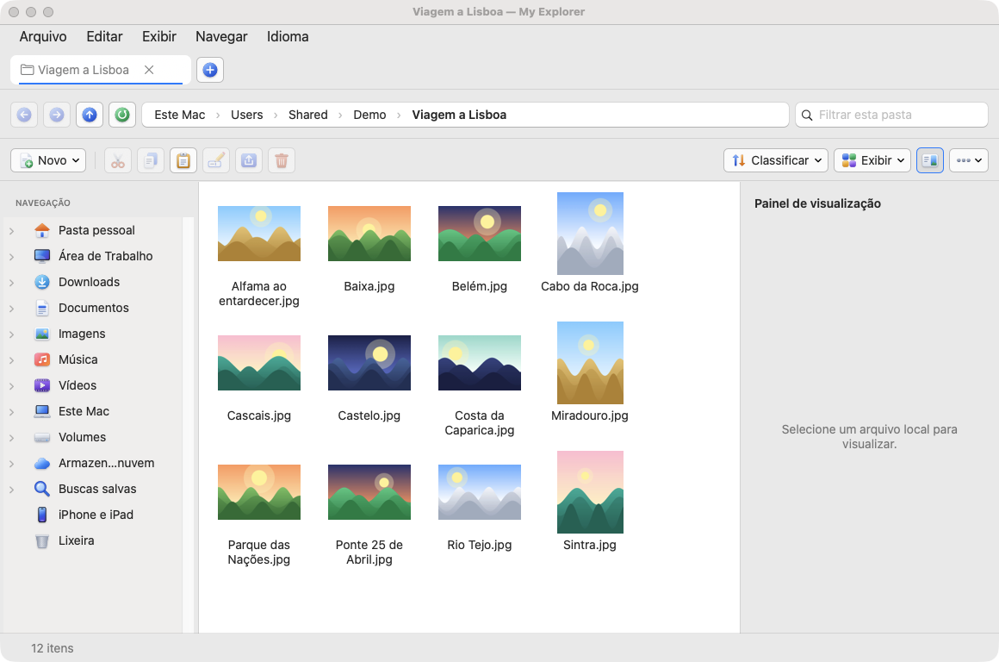
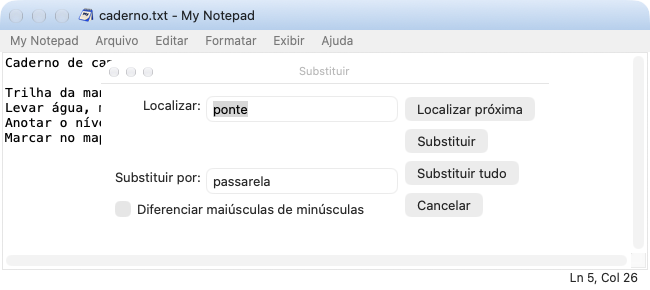
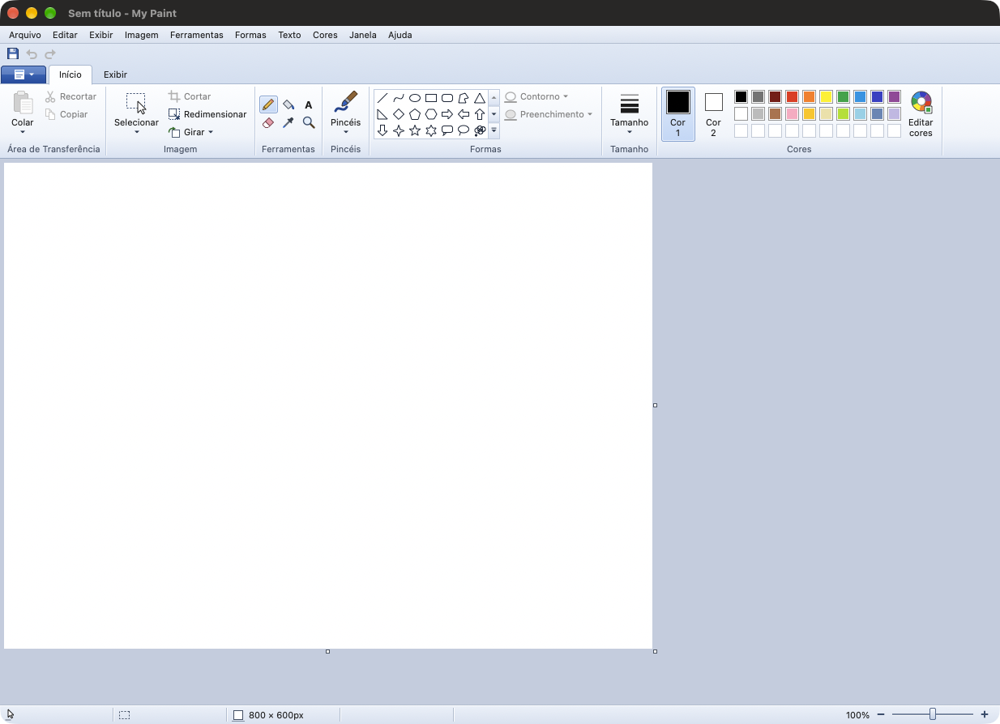

# My Suite

**Português (Brasil)** · [English](docs/readme/en.md) · [Español](docs/readme/es.md) · [Français](docs/readme/fr.md) · [Deutsch](docs/readme/de.md) · [Italiano](docs/readme/it.md) · [日本語](docs/readme/ja.md) · [한국어](docs/readme/ko.md)

Três aplicativos para macOS simples e diretos, com os menus e os atalhos de sempre: um gerenciador de arquivos, um editor de texto e um editor de imagens. Cada um tem repositório, versão e download próprios; este repositório reúne os três num instalador só.

## Instalar

- **[Baixar para Apple Silicon (série M)](https://github.com/leoars/my-suite/releases/download/1.0.4/My-Suite-1.0.4-arm64.pkg)**
- **[Baixar para Intel](https://github.com/leoars/my-suite/releases/download/1.0.4/My-Suite-1.0.4-x86_64.pkg)**

O instalador traz o My Explorer 1.0.3, o My Notepad 1.0.5 e o My Paint 1.0.1. Abra-o e, em **Personalizar**, escolha quais aplicativos instalar; os três vêm marcados. Ele é assinado com Developer ID e notarizado pela Apple, e fala português, inglês, espanhol, francês, alemão, italiano, japonês e coreano.

Requer macOS 12 ou posterior. O My Explorer requer macOS 14 ou posterior: em versões anteriores ele aparece desmarcado e os outros dois são instalados normalmente.

## My Explorer

Gerenciador de arquivos com árvore de pastas, abas, barra de comandos e várias visualizações, integrado à Lixeira, aos volumes, ao iCloud e aos aplicativos do Mac.



### Navegação

- Árvore de pastas com Pasta pessoal, Área de Trabalho, Documentos, Downloads, Este Mac, Volumes, Armazenamento em nuvem, Buscas salvas, iPhone e iPad e Lixeira, além das pastas preferidas e recentes.
- Abas, cada uma com histórico, seleção, ordenação e filtro próprios.
- Uma barra de endereço só: a trilha de pastas é clicável e vira o caminho em texto quando você clica nela, com sugestões enquanto digita.
- **Voltar**, **Avançar**, **Subir** e **Atualizar**; a lista se atualiza sozinha quando os arquivos mudam por fora.
- **Filtrar esta pasta** pelo nome, com curingas (`*.pdf`), e **Pesquisar arquivos…** por nome, extensão, conteúdo, data e etiquetas, nesta pasta ou no Mac inteiro. As buscas podem ser salvas na árvore.

### Visualizações

- Cinco modos, lembrados por pasta: **Detalhes**, **Lista**, **Ícones pequenos**, **Ícones grandes** e **Galeria**, com miniaturas de fotos e vídeos.
- **Classificar** por nome, data de modificação, tipo ou tamanho; em Detalhes, arraste os cabeçalhos para mudar a ordem e a largura das colunas.
- **Itens ocultos** e **Extensões de nomes de arquivo** no menu Exibir.

### Operações com arquivos

- Barra de comandos com **Novo**, **Recortar**, **Copiar**, **Colar**, **Renomear**, **Compartilhar** e **Excluir**.
- Copiar e mover com progresso, pausa e verificação. Se o nome já existir: substituir, mesclar pastas, manter ambos ou ignorar.
- **Desfazer** para até 20 cópias, movimentações e exclusões da sessão, e renomear no próprio lugar com F2.
- Lixeira na árvore, com **Restaurar**, **Excluir definitivamente…** e **Esvaziar Lixeira…**.
- **Compactar para ZIP** e **Extrair ZIP**, arrastar e soltar entre aplicativos, **Abrir com…**, **Compartilhar…** (inclusive por AirDrop), etiquetas do Finder e **Copiar caminho**.
- **Propriedades** com caminho e permissões; em um volume, capacidade total, usada e livre.
- Ações rápidas para imagens e PDFs: girar, converter em JPEG ou PNG e criar PDF.

### Visualização e mídia

- O painel de visualização mostra imagens, vídeo e áudio com controles de reprodução, PDF com passagem de páginas, Markdown formatado (com tabelas, listas de tarefas e realce de código, ou o código-fonte) e os demais tipos pelo Quick Look.
- Um visualizador próprio abre imagens, vídeos e áudios, avança pelos arquivos da pasta com as setas e dá zoom de 1% a 800%. Imagens animadas (WebP, GIF, APNG) são reproduzidas.

### Reconhecimento de texto (OCR)

- **Extrair texto…** de imagens e PDFs digitalizados, com detecção do idioma, para copiar ou salvar como TXT.
- **Criar PDF pesquisável…**, um arquivo por vez ou em lote de até 50. Tudo é feito no próprio Mac.

### iCloud e armazenamento em nuvem

- Estado de cada item do iCloud Drive na lista (no Mac, somente on-line, baixando ou enviando), download com um clique e progresso no ícone, e **Remover download deste Mac**.
- Baixar uma pasta inteira ou só a seleção, com uma reserva de espaço em disco que nunca é ultrapassada.
- Amazon S3: conectar um bucket, navegar, copiar entre o Mac e a nuvem, mover, criar pastas e excluir, com as credenciais nas Chaves do macOS. Azure Blob Storage e Google Cloud Storage são experimentais.

### Pastas protegidas, Git e rede

- **Proteger pasta…** guarda uma pasta em um cofre cifrado com AES-256, aberto por senha, que se bloqueia sozinho ao bloquear a sessão, ao dormir e ao sair.
- Git: marcas de estado nos arquivos, a branch na barra de status, **Ver alterações**, **Ver histórico**, commit, troca de branch, fetch, pull e push, usando o Git instalado no Mac.
- Ejetar discos, **Conectar ao servidor…** por SMB e importar fotos de um iPhone ou iPad.

### Opções e atalhos

- Restaurar as abas ou a última pasta ao abrir, tamanhos de fonte separados para a árvore, a lista, os menus e as barras, e tema claro ou escuro seguindo o sistema.
- Os atalhos com Ctrl funcionam como você já conhece (Ctrl+C, Ctrl+V, F2, F5, Ctrl+T para nova aba), e os equivalentes com ⌘ também.
- Verifica novas versões ao abrir e instala a que você aceitar.
- Experimental e desligado por padrão: uma linha de comando e um servidor MCP permitem que um assistente de IA trabalhe em pastas que você autorizar, por 24 horas.

Requer macOS 14 ou posterior. [Conheça o My Explorer](https://github.com/leoars/my-explorer/blob/main/README.pt-BR.md)

## My Notepad

Editor de texto simples: abra um .txt, escreva e salve com os atalhos que você já conhece.



- **Texto simples de verdade:** sem corretor ortográfico, sem substituições automáticas e sem formatação escondida.
- **Arquivo:** Novo, Abrir, Salvar e Salvar como, com aviso antes de perder alterações. Na primeira abertura, oferece ser o editor padrão de arquivos .txt.
- **Janelas e sessão:** cada documento na sua janela, com **Nova janela**. O que não foi salvo fica guardado e volta na próxima abertura, sem perguntar ao fechar; em **Ajustes…** dá para voltar a ser perguntado.
- **Localizar** com direção e diferenciação de maiúsculas, **Substituir** e **Substituir tudo** num painel que fica aberto enquanto você trabalha, e **Ir para** uma linha pelo número.
- **Codificações:** abre e salva em ANSI (CP-1252), UTF-8, UTF-16 LE e UTF-16 BE, com detecção automática, e mantém os fins de linha CRLF, LF ou CR do arquivo.
- **Exibir:** quebra automática de linha, escolha de fonte, tamanho da fonte pelo teclado ou com Ctrl e a roda do mouse, e barra de status com linha e coluna.
- **Imprimir:** Configurar página com cabeçalho, rodapé (`&f`, `&p`, `&d`, `&t`), margens, papel e orientação.
- **Hora/data** com F5 e o diário em .txt: um arquivo que começa com `.LOG` ganha a hora e a data no fim a cada abertura.
- **Atalhos de sempre:** Ctrl+S, Ctrl+F, F3, Ctrl+H, Ctrl+G, Ctrl+Backspace e os demais, com os equivalentes em ⌘.

Requer macOS 12 ou posterior. [Conheça o My Notepad](https://github.com/leoars/My-Notepad)

## My Paint

Editor de imagens simples: abra uma imagem, desenhe com lápis, pincéis, formas e texto, e salve em PNG, JPEG, BMP ou GIF.



- **Arquivo:** abre e salva PNG, JPEG, BMP, GIF e TIFF, com imagens recentes, Propriedades da imagem e Definir como plano de fundo da área de trabalho.
- **Ferramentas:** lápis, borracha, preencher com cor, selecionador de cor, lupa e texto; o botão esquerdo pinta com a Cor 1 e o direito com a Cor 2.
- **Nove pincéis**, entre eles caligráficos, spray, óleo, giz de cera e aquarela, cada um com quatro tamanhos.
- **23 formas** da galeria, com contorno e preenchimento em cor sólida ou textura, ajustáveis pelas alças antes de fixar.
- **Cores:** paleta de 20 cores, cores personalizadas e Editar cores por matiz, saturação e luminosidade ou por RGB.
- **Seleção** retangular, de forma livre e transparente; mover, duplicar, esticar e colar entre aplicativos.
- **Imagem:** cortar, redimensionar e inclinar, girar, inverter e inverter cor, na seleção ou na imagem inteira.
- **Texto** com fonte, tamanho, negrito, itálico, sublinhado e tachado, e suporte aos métodos de entrada do japonês e do coreano.
- **Exibir e imprimir:** zoom de 12,5% a 800%, réguas, linhas de grade, tela inteira, miniatura, Visualizar impressão e Desfazer com 50 níveis.

Requer macOS 12 ou posterior. [Conheça o My Paint](https://github.com/leoars/my-paint)

## Como os aplicativos trabalham juntos

- No My Explorer, o duplo clique em um arquivo de texto abre o My Notepad, e o menu de contexto oferece **Editar com o My Notepad** e **Editar com o My Paint**.
- A janela **Sobre** de cada aplicativo leva aos outros dois.
- Nenhum depende do outro: instale só os que quiser.

## Atualizações

Os três aplicativos verificam novas versões ao abrir e instalam a que você aceitar; em cada um, a opção **Verificar novas versões ao abrir** fica nas Opções ou nos Ajustes, com **Verificar agora**. O My Notepad e o My Paint fazem isso desde as versões 1.0.5 e 1.0.1: ao aceitar, o instalador novo é conferido e abre no Instalador do macOS. Quem tem uma versão anterior deles atualiza uma vez por este instalador ou pelo de cada aplicativo.

## Gerar o instalador

`build.sh` monta o instalador a partir dos aplicativos já publicados e notarizados; nada é compilado aqui. O número da suíte fica em `VERSION`.

```sh
DEVELOPER_ID_INSTALLER="Developer ID Installer: …" NOTARY_PROFILE=my-suite-notary ./build.sh
```

Distribuído sob a [licença Apache 2.0](LICENSE).
