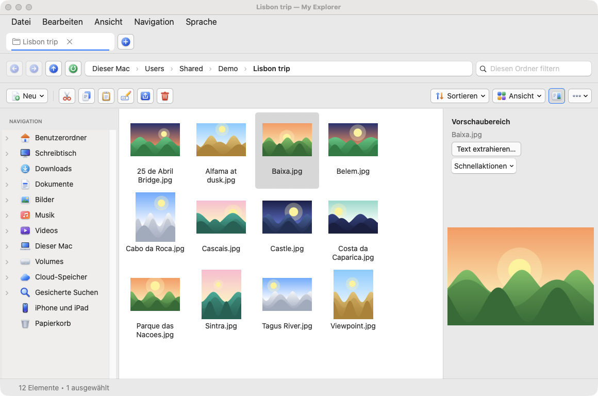
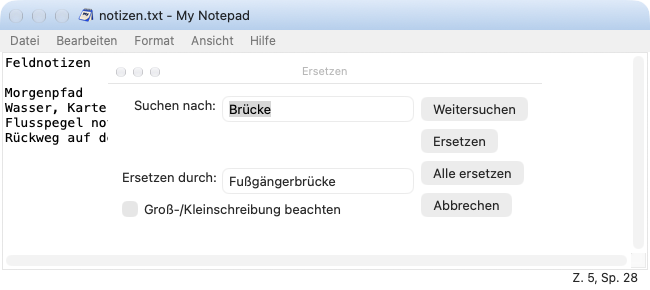

# My Suite

[Português (Brasil)](../../README.md) · [English](en.md) · [Español](es.md) · [Français](fr.md) · **Deutsch** · [Italiano](it.md) · [日本語](ja.md) · [한국어](ko.md)

Drei einfache, geradlinige Apps für macOS, mit den Menüs und Tastenkürzeln, die du schon kennst: ein Dateimanager, ein Texteditor und ein Bildeditor. Jede hat ihr eigenes Repository, ihre eigene Version und ihren eigenen Download; dieses Repository bündelt alle drei in einem einzigen Installationsprogramm.

## Installieren

- **[Für Apple Silicon (M-Serie) herunterladen](https://github.com/leoars/my-suite/releases/download/1.0.1/My-Suite-1.0.1-arm64.pkg)**
- **[Für Intel herunterladen](https://github.com/leoars/my-suite/releases/download/1.0.1/My-Suite-1.0.1-x86_64.pkg)**

Das Installationsprogramm enthält My Explorer 1.0.1, My Notepad 1.0.2 und My Paint 1.0. Öffne es und wähle unter **Anpassen**, welche Apps installiert werden sollen; alle drei sind ausgewählt. Es ist mit Developer ID signiert und von Apple notarisiert und spricht Englisch, Portugiesisch, Spanisch, Französisch, Deutsch, Italienisch, Japanisch und Koreanisch.

Erfordert macOS 12 oder neuer. My Explorer erfordert macOS 14 oder neuer: Auf älteren Versionen erscheint es nicht ausgewählt, und die beiden anderen werden normal installiert.

## My Explorer

Ein Dateimanager mit Ordnerbaum, Tabs, Befehlsleiste und mehreren Ansichten, verbunden mit Papierkorb, Volumes, iCloud und den Apps des Mac.



- **Navigation:** ein Baum mit den Ordnern des Mac, favorisierte und zuletzt geöffnete Ordner, Tabs mit eigenem Verlauf, eine Adressleiste, die beim Anklicken zu Text wird, und ein Ordnerfilter mit Platzhaltern (`*.pdf`).
- **Fünf Ansichten**, die sich die App für jeden Ordner merkt: Details, Liste, Kleine Symbole, Große Symbole und Galerie, mit Miniaturen von Fotos und Videos.
- **Dateioperationen:** Kopieren und Bewegen mit Fortschritt und Pause, Rückgängig, Papierkorb mit Zurücklegen, ZIP, Eigenschaften mit Ordnergrößen und schnelles Löschen Tausender Dateien.
- **Vorschau:** Bilder, Video, Audio und PDF im Vorschaubereich und in einem eigenen Betrachter.
- **Und mehr:** Text aus Bildern und PDFs (OCR), iCloud-Drive-Status, Amazon S3, passwortgeschützte Ordner, Git und Verbindung zu SMB-Servern.

Erfordert macOS 14 oder neuer. [Mehr über My Explorer](https://github.com/leoars/my-explorer/blob/main/README.de.md)

## My Notepad

Ein einfacher Texteditor: Öffne eine .txt-Datei, schreibe und speichere mit den Tastenkürzeln, die du schon kennst.



- **Wirklich reiner Text:** keine Rechtschreibprüfung, keine automatischen Ersetzungen und keine versteckte Formatierung.
- **Suchen, Ersetzen** und **Gehe zu** einer Zeile über ihre Nummer.
- **Codierungen** ANSI, UTF-8 und UTF-16, automatisch erkannt, wobei die Zeilenenden der Datei erhalten bleiben.
- **Zeilenumbruch**, Wahl der Schriftart und eine Statusleiste mit Zeile und Spalte.
- **Seite einrichten und Drucken**, mit Kopf- und Fußzeile, und das Tagebuch als .txt-Datei mit `.LOG`.

Erfordert macOS 12 oder neuer. [Mehr über My Notepad](https://github.com/leoars/My-Notepad/blob/main/docs/readme/de.md)

## My Paint

Ein einfacher Bildeditor: Öffne ein Bild, zeichne mit Stiften, Pinseln, Formen und Text und speichere als PNG, JPEG, BMP oder GIF.


- **Werkzeuge:** Stift, Radierer, Mit Farbe füllen, Farbpipette, Lupe und Text.
- **Neun Pinsel** und die **23 Formen** der Galerie, mit Umriss und Füllung.
- **Farben:** Farbe 1 und Farbe 2, eine Palette aus 20 Farben und eigene Farben.
- **Auswahl**, rechteckig und als Freihandauswahl, mit Ausschneiden, Kopieren und Einfügen zwischen Apps.
- **Bild:** zuschneiden, Größe ändern, neigen, drehen und spiegeln.

Erfordert macOS 12 oder neuer. [Mehr über My Paint](https://github.com/leoars/my-paint/blob/main/docs/readme/de.md)

## So arbeiten die Apps zusammen

- In My Explorer öffnet ein Doppelklick auf eine Textdatei My Notepad, und das Kontextmenü bietet **Mit My Notepad bearbeiten** und **Mit My Paint bearbeiten**.
- Das Fenster **Über** jeder App führt zu den beiden anderen.
- Keine hängt von einer anderen ab: Installiere nur die, die du möchtest.

## Updates

My Explorer sucht selbst nach neuen Versionen und installiert die, der du zustimmst. My Notepad und My Paint werden aktualisiert, indem du die neue Version installierst, mit diesem Installationsprogramm oder mit dem der jeweiligen App.

## Das Installationsprogramm erstellen

`build.sh` stellt das Installationsprogramm aus den bereits veröffentlichten und notarisierten Apps zusammen; hier wird nichts kompiliert. Die Versionsnummer der Suite steht in `VERSION`.

```sh
DEVELOPER_ID_INSTALLER="Developer ID Installer: …" NOTARY_PROFILE=my-suite-notary ./build.sh
```

Veröffentlicht unter der [Apache-Lizenz 2.0](../../LICENSE).
