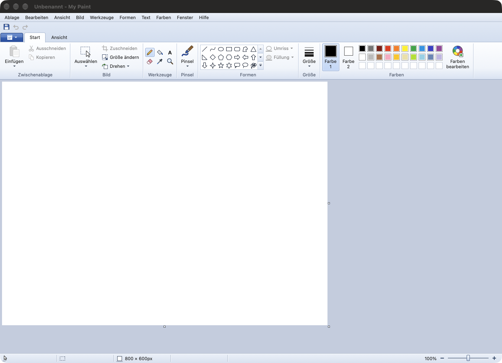

# My Suite

[Português (Brasil)](../../README.md) · [English](en.md) · [Español](es.md) · [Français](fr.md) · **Deutsch** · [Italiano](it.md) · [日本語](ja.md) · [한국어](ko.md)

Vier einfache, geradlinige Apps für macOS, mit den Menüs und Tastenkürzeln, die du schon kennst: ein Dateimanager, ein Texteditor, ein Bildeditor und ein Rechner. Jede hat ihr eigenes Repository, ihre eigene Version und ihren eigenen Download; dieses Repository bündelt alle vier in einem einzigen Installationsprogramm.

## Installieren

- **[Für Apple Silicon (M-Serie) herunterladen](https://github.com/leoars/my-suite/releases/download/1.0.6/My-Suite-1.0.6-arm64.pkg)**
- **[Für Intel herunterladen](https://github.com/leoars/my-suite/releases/download/1.0.6/My-Suite-1.0.6-x86_64.pkg)**

Das Installationsprogramm enthält My Explorer 1.0.3, My Notepad 1.0.6, My Paint 1.0.1 und My Calc 1.0. Öffne es und wähle unter **Anpassen**, welche Apps installiert werden sollen; alle vier sind ausgewählt. Es ist mit Developer ID signiert und von Apple notarisiert und spricht Englisch, Portugiesisch, Spanisch, Französisch, Deutsch, Italienisch, Japanisch und Koreanisch.

Erfordert macOS 12 oder neuer. My Explorer erfordert macOS 14 oder neuer: Auf älteren Versionen erscheint es nicht ausgewählt, und die drei anderen werden normal installiert.

## My Explorer

Ein Dateimanager mit Ordnerbaum, Tabs, Befehlsleiste und mehreren Ansichten, verbunden mit Papierkorb, Volumes, iCloud und den Apps des Mac.


### Navigation

- Ordnerbaum mit Benutzerordner, Schreibtisch, Dokumente, Downloads, Dieser Mac, Volumes, Cloud-Speicher, Gesicherte Suchen, iPhone und iPad sowie Papierkorb, dazu favorisierte und zuletzt geöffnete Ordner.
- Tabs, jeder mit eigenem Verlauf, eigener Auswahl, Sortierung und eigenem Filter.
- Eine einzige Adressleiste: Der Ordnerpfad ist anklickbar und wird beim Anklicken zum Pfad als Text, mit Vorschlägen während der Eingabe.
- **Zurück**, **Vorwärts**, **Übergeordneter Ordner** und **Aktualisieren**; die Liste aktualisiert sich von selbst, wenn sich Dateien außerhalb der App ändern.
- **Diesen Ordner filtern** nach Namen, mit Platzhaltern (`*.pdf`), und **Dateien suchen…** nach Name, Erweiterung, Inhalt, Datum und Tags, in diesem Ordner oder auf dem gesamten Mac. Suchen lassen sich im Baum sichern.

### Ansichten

- Fünf Modi, die sich die App für jeden Ordner merkt: **Details**, **Liste**, **Kleine Symbole**, **Große Symbole** und **Galerie**, mit Miniaturen von Fotos und Videos.
- **Sortieren** nach Name, Änderungsdatum, Typ oder Größe; in „Details“ änderst du durch Ziehen der Spaltenköpfe die Reihenfolge und die Breite der Spalten.
- **Ausgeblendete Elemente** und **Dateinamenerweiterungen** im Menü „Ansicht“.

### Dateioperationen

- Befehlsleiste mit **Neu**, **Ausschneiden**, **Kopieren**, **Einfügen**, **Umbenennen**, **Teilen** und **Löschen**.
- Kopieren und Bewegen mit Fortschritt, Pause und Überprüfung. Wenn der Name bereits vorhanden ist: ersetzen, Ordner zusammenführen, beide behalten oder überspringen.
- **Rückgängig** für bis zu 20 Kopier-, Verschiebe- und Löschvorgänge der Sitzung und Umbenennen an Ort und Stelle mit F2.
- Papierkorb im Baum, mit **Zurücklegen**, **Endgültig löschen…** und **Papierkorb entleeren…**.
- **Als ZIP komprimieren** und **ZIP entpacken**, Drag & Drop zwischen Apps, **Öffnen mit…**, **Teilen…** (auch per AirDrop), Finder-Tags und **Pfad kopieren**.
- **Eigenschaften** mit Pfad und Zugriffsrechten; bei einem Volume gesamte, belegte und freie Kapazität.
- Schnellaktionen für Bilder und PDFs: drehen, in JPEG oder PNG konvertieren und PDF erstellen.

### Vorschau und Medien

- Der Vorschaubereich zeigt Bilder, Video und Audio mit Wiedergabesteuerung, PDFs zum Blättern, formatiertes Markdown (mit Tabellen, Aufgabenlisten und Codehervorhebung oder als Quelltext) und alle übrigen Typen über die Übersicht (Quick Look).
- Ein eigener Betrachter öffnet Bilder, Videos und Audiodateien, wechselt mit den Pfeiltasten durch die Dateien des Ordners und zoomt von 1 % bis 800 %. Animierte Bilder (WebP, GIF, APNG) werden abgespielt.

### Texterkennung (OCR)

- **Text extrahieren…** aus Bildern und gescannten PDFs, mit Spracherkennung, zum Kopieren oder Sichern als TXT.
- **Durchsuchbare PDF erstellen…**, für eine einzelne Datei oder im Stapel mit bis zu 50 Dateien. Alles geschieht direkt auf dem Mac.

### iCloud und Cloud-Speicher

- Status jedes Objekts in iCloud Drive in der Liste (auf dem Mac, nur online, wird geladen oder wird hochgeladen), Laden mit einem Klick und Fortschritt am Symbol sowie **Download von diesem Mac entfernen**.
- Den gesamten Inhalt eines Ordners oder nur die Auswahl laden, mit einer Speicherplatzreserve, die nie unterschritten wird.
- Amazon S3: einen Bucket verbinden, durchsuchen, zwischen Mac und Cloud kopieren, bewegen, Ordner anlegen und löschen, mit den Zugangsdaten im Schlüsselbund von macOS. Azure Blob Storage und Google Cloud Storage sind experimentell.

### Geschützte Ordner, Git und Netzwerk

- **Ordner schützen…** legt einen Ordner in einem mit AES-256 verschlüsselten Tresor ab, der sich mit einem Passwort öffnen lässt und sich beim Sperren der Sitzung, beim Ruhezustand und beim Beenden von selbst sperrt.
- Git: Statusmarkierungen an den Dateien, der Branch in der Statusleiste, **Änderungen anzeigen**, **Verlauf anzeigen**, Commit, Branch wechseln, Fetch, Pull und Push, mit dem auf dem Mac installierten Git.
- Datenträger auswerfen, **Mit Server verbinden…** über SMB und Fotos von einem iPhone oder iPad importieren.

### Optionen und Tastenkürzel

- Tabs oder den letzten Ordner beim Öffnen wiederherstellen, getrennte Schriftgrößen für Baum, Liste, Menüs und Leisten sowie helles oder dunkles Design, passend zum System.
- Die Tastenkürzel mit Strg funktionieren so, wie du sie schon kennst (Strg+C, Strg+V, F2, F5, Strg+T für einen neuen Tab), die Entsprechungen mit ⌘ ebenfalls.
- Sucht beim Öffnen nach neuen Versionen und installiert die, der du zustimmst.
- Experimentell und standardmäßig ausgeschaltet: Ein Kommandozeilenwerkzeug und ein MCP-Server erlauben einem KI-Assistenten, 24 Stunden lang in den Ordnern zu arbeiten, die du freigibst.

Erfordert macOS 14 oder neuer. [Mehr über My Explorer](https://github.com/leoars/my-explorer/blob/main/README.de.md)

## My Notepad

Ein einfacher Texteditor: Öffne eine .txt-Datei, schreibe und speichere mit den Tastenkürzeln, die du schon kennst.


- **Wirklich reiner Text:** keine Rechtschreibprüfung, keine automatischen Ersetzungen und keine versteckte Formatierung.
- **Datei:** Neu, Öffnen, Benutzte Dokumente öffnen (die letzten zehn Dateien), Speichern und Speichern unter, mit einer Rückfrage, bevor Änderungen verloren gehen. Beim ersten Öffnen bietet die App an, Standardeditor für .txt-Dateien zu werden.
- **Fenster und Sitzung:** jedes Dokument in einem eigenen Fenster, mit **Neues Fenster**. Nicht Gespeichertes bleibt erhalten und ist beim nächsten Öffnen wieder da, ohne Rückfrage beim Schließen; unter **Einstellungen…** lässt sich die Rückfrage wieder einschalten.
- **Suchen** mit Suchrichtung und Beachtung der Groß-/Kleinschreibung, **Ersetzen** und **Alle ersetzen** in einem Fenster, das offen bleibt, während du arbeitest, und **Gehe zu** einer Zeile über ihre Nummer.
- **Codierungen:** öffnet und speichert ANSI (CP-1252), UTF-8, UTF-16 LE und UTF-16 BE, mit automatischer Erkennung, und behält die Zeilenenden CRLF, LF oder CR der Datei bei.
- **Ansicht:** Zeilenumbruch, Wahl der Schriftart, Schriftgröße über die Tastatur oder mit Strg und dem Mausrad sowie eine Statusleiste mit Zeile und Spalte.
- **Drucken:** Seite einrichten mit Kopfzeile, Fußzeile (`&f`, `&p`, `&d`, `&t`), Seitenrändern, Papier und Ausrichtung.
- **Uhrzeit/Datum** mit F5 und das Tagebuch als .txt-Datei: Eine Datei, die mit `.LOG` beginnt, erhält bei jedem Öffnen Uhrzeit und Datum am Ende.
- **Vertraute Tastenkürzel:** Strg+S, Strg+F, F3, Strg+H, Strg+G, Strg+Backspace und die übrigen, mit den Entsprechungen mit ⌘.

Erfordert macOS 12 oder neuer. [Mehr über My Notepad](https://github.com/leoars/My-Notepad/blob/main/docs/readme/de.md)

## My Paint

Ein einfacher Bildeditor: Öffne ein Bild, zeichne mit Stiften, Pinseln, Formen und Text und speichere als PNG, JPEG, BMP oder GIF.



- **Datei:** öffnet und speichert PNG, JPEG, BMP, GIF und TIFF, mit „Zuletzt verwendete Bilder“, „Bildeigenschaften“ und „Als Schreibtischhintergrund festlegen“.
- **Werkzeuge:** Stift, Radierer, Mit Farbe füllen, Farbpipette, Lupe und Text; die linke Taste malt mit Farbe 1, die rechte mit Farbe 2.
- **Neun Pinsel**, darunter Kalligrafiepinsel, Airbrush, Ölpinsel, Wachsmalstift und Aquarellpinsel, jeweils in vier Größen.
- **23 Formen** der Galerie, mit Umriss und Füllung als Volltonfarbe oder Textur, die sich vor dem Festlegen an den Griffen anpassen lassen.
- **Farben:** eine Palette aus 20 Farben, eigene Farben und „Farben bearbeiten“ über Farbton, Sättigung und Helligkeit oder über RGB.
- **Auswahl**, rechteckig, als Freihandauswahl und transparent; bewegen, duplizieren, strecken und zwischen Apps einfügen.
- **Bild:** zuschneiden, Größe ändern und neigen, drehen, spiegeln und Farben umkehren, für die Auswahl oder das ganze Bild.
- **Text** mit Schriftart, Größe, fett, kursiv, unterstrichen und durchgestrichen sowie Unterstützung der Eingabemethoden für Japanisch und Koreanisch.
- **Ansicht und Drucken:** Zoom von 12,5 % bis 800 %, Lineale, Gitternetz, Vollbild, Miniatur, Druckvorschau und Rückgängig über 50 Schritte.

Erfordert macOS 12 oder neuer. [Mehr über My Paint](https://github.com/leoars/my-paint/blob/main/docs/readme/de.md)

## My Calc

Ein einfacher Rechner: Rechne im Standard-, im wissenschaftlichen oder im Programmierermodus – mit den Tasten und Tastenkürzeln, die du schon kennst.


- **Standard:** die vier Grundrechenarten, Prozent, Kehrwert, Quadrat und Quadratwurzel, in der Reihenfolge, in der die Tasten gedrückt werden.
- **Wissenschaftlich:** Operatorrangfolge und Klammern; Trigonometrie in Grad, Bogenmaß oder Neugrad; Potenzen, Logarithmen und Fakultät.
- **Programmierer:** die Zahl gleichzeitig in HEX, DEC, OCT und BIN, Wörter von 8 bis 64 Bit, Bitoperationen und ein Feld mit den 64 Bits.
- **Speicher und Verlauf:** MS, MR, M+, M− und MC mit einer Liste der gespeicherten Zahlen sowie der Verlauf der Rechnungen; Zahlen oder ganze Rechnungen kopieren und einfügen.
- **Dezimalarithmetik** mit 32 signifikanten Stellen: 0,1 + 0,2 ergibt 0,3.
- Helles oder dunkles Erscheinungsbild wie im System, ein Fenster mit veränderbarer Größe und **Immer im Vordergrund**.

Erfordert macOS 12 oder neuer. [Mehr über My Calc](https://github.com/leoars/my-calc/blob/main/docs/readme/de.md)

## So arbeiten die Apps zusammen

- In My Explorer öffnet ein Doppelklick auf eine Textdatei My Notepad, und das Kontextmenü bietet **Mit My Notepad bearbeiten** und **Mit My Paint bearbeiten**.
- Das Fenster **Über** von My Explorer, My Notepad und My Paint führt zu den beiden anderen, das von My Calc zu den drei anderen.
- Keine hängt von einer anderen ab: Installiere nur die, die du möchtest.

## Updates

Alle vier Apps suchen beim Öffnen nach neuen Versionen und installieren die, der du zustimmst; jede hat **Beim Start nach Updates suchen** in ihren Optionen oder Einstellungen, mit **Jetzt prüfen**. My Notepad und My Paint tun das ab den Versionen 1.0.5 und 1.0.1: Nach der Zustimmung wird das neue Installationspaket geprüft und im macOS-Installationsprogramm geöffnet. Mit einer älteren Version aktualisierst du einmal mit diesem Installationsprogramm oder mit dem der jeweiligen App.

## Das Installationsprogramm erstellen

`build.sh` stellt das Installationsprogramm aus den bereits veröffentlichten und notarisierten Apps zusammen; hier wird nichts kompiliert. Die Versionsnummer der Suite steht in `VERSION`.

```sh
DEVELOPER_ID_INSTALLER="Developer ID Installer: …" NOTARY_PROFILE=my-suite-notary ./build.sh
```

Veröffentlicht unter der [Apache-Lizenz 2.0](../../LICENSE).
