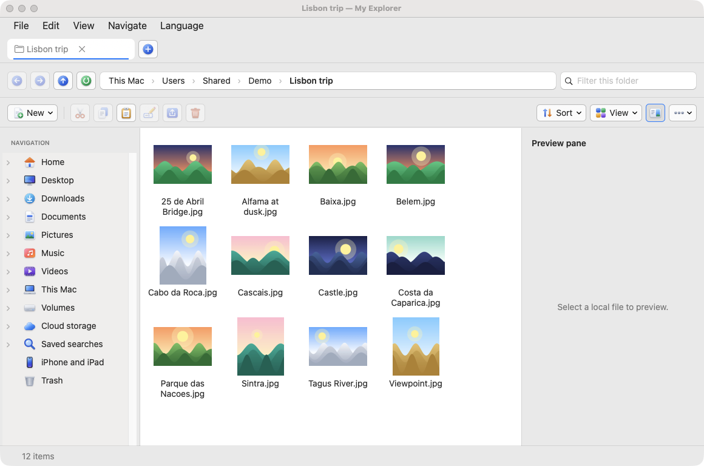
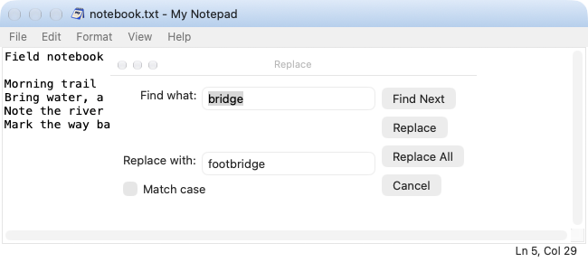

# My Suite

[Português (Brasil)](../../README.md) · **English** · [Español](es.md) · [Français](fr.md) · [Deutsch](de.md) · [Italiano](it.md) · [日本語](ja.md) · [한국어](ko.md)

Three simple, straightforward apps for macOS, with the menus and shortcuts you already know: a file manager, a text editor and an image editor. Each one has its own repository, version and download; this repository brings the three together in a single installer.

## Install

- **[Download for Apple Silicon (M-series)](https://github.com/leoars/my-suite/releases/download/1.0.5/My-Suite-1.0.5-arm64.pkg)**
- **[Download for Intel](https://github.com/leoars/my-suite/releases/download/1.0.5/My-Suite-1.0.5-x86_64.pkg)**

The installer brings My Explorer 1.0.3, My Notepad 1.0.6 and My Paint 1.0.1. Open it and, under **Customize**, choose which apps to install; all three come selected. It is signed with Developer ID and notarized by Apple, and speaks English, Portuguese, Spanish, French, German, Italian, Japanese and Korean.

Requires macOS 12 or later. My Explorer requires macOS 14 or later: on earlier versions it appears unselected and the other two are installed normally.

## My Explorer

A file manager with a folder tree, tabs, a command bar and several views, working with the Trash, volumes, iCloud and the Mac's apps.



### Navigation

- Folder tree with Home, Desktop, Documents, Downloads, This Mac, Volumes, Cloud storage, Saved searches, iPhone and iPad, and Trash, plus favorite and recent folders.
- Tabs, each with its own history, selection, sorting and filter.
- A single address bar: the folder trail is clickable and turns into the path as text when you click it, with suggestions as you type.
- **Back**, **Forward**, **Up** and **Refresh**; the list refreshes by itself when files change outside the app.
- **Filter this folder** by name, with wildcards (`*.pdf`), and **Search Files…** by name, extension, content, date and tags, in this folder or across the whole Mac. Searches can be saved to the tree.

### Views and sorting

- Five modes, remembered per folder: **Details**, **List**, **Small icons**, **Large icons** and **Gallery**, with photo and video thumbnails.
- **Sort** by name, date modified, type or size; in Details, drag the headers to change the order and width of the columns.
- **Hidden items** and **File name extensions** in the View menu.

### File operations

- Command bar with **New**, **Cut**, **Copy**, **Paste**, **Rename**, **Share** and **Delete**.
- Copy and move with progress, pause and verification. If the name already exists: replace, merge folders, keep both or skip.
- **Undo** for up to 20 copies, moves and deletions in the session, and rename in place with F2.
- Trash in the tree, with **Put Back**, **Delete Permanently…** and **Empty Trash…**.
- **Compress to ZIP** and **Extract ZIP**, drag and drop between apps, **Open with…**, **Share…** (including AirDrop), Finder tags and **Copy path**.
- **Properties** with path and permissions; on a volume, total, used and free capacity.
- Quick actions for images and PDFs: rotate, convert to JPEG or PNG, and create a PDF.

### Preview pane and media viewer

- The preview pane shows images, video and audio with playback controls, PDFs with page navigation, formatted Markdown (with tables, task lists and code highlighting, or the source), and other types through Quick Look.
- A viewer of its own opens images, videos and audio, moves through the folder's files with the arrow keys and zooms from 1% to 800%. Animated images (WebP, GIF, APNG) play.

### Text recognition (OCR)

- **Extract text…** from images and scanned PDFs, with language detection, to copy or save as TXT.
- **Create searchable PDF…**, one file at a time or in batches of up to 50. Everything is done on the Mac itself.

### iCloud and cloud storage

- The state of each iCloud Drive item in the list (on the Mac, online only, downloading or uploading), one-click download with progress on the icon, and **Remove download from this Mac**.
- Download a whole folder or just the selection, with a disk space reserve that is never exceeded.
- Amazon S3: connect a bucket, browse, copy between the Mac and the cloud, move, create folders and delete, with credentials kept in the macOS Keychain. Azure Blob Storage and Google Cloud Storage are experimental.

### Protected folders, Git and network

- **Protect folder…** keeps a folder in a vault encrypted with AES-256 and opened with a password, which locks automatically when the session is locked, when the Mac sleeps and on quit.
- Git: state badges on the files, the branch in the status bar, **View changes**, **View history**, commit, switch branches, fetch, pull and push, using the Git installed on the Mac.
- Eject disks, **Connect to server…** over SMB and import photos from an iPhone or iPad.

### Options and shortcuts

- Restore the tabs or the last folder at launch, separate font sizes for the tree, the list, the menus and the bars, and a light or dark theme following the system.
- The Ctrl shortcuts work the way you already know (Ctrl+C, Ctrl+V, F2, F5, Ctrl+T for a new tab), and so do their ⌘ equivalents.
- Checks for new versions at launch and installs the one you accept.
- Experimental and off by default: a command line tool and an MCP server let an AI assistant work in folders you authorize, for 24 hours.

Requires macOS 14 or later. [Learn more about My Explorer](https://github.com/leoars/my-explorer)

## My Notepad

A simple text editor: open a .txt file, write and save with the shortcuts you already know.



- **Truly plain text:** no spell checker, no automatic substitutions and no hidden formatting.
- **File:** **New**, **Open…**, **Open Recent** (the last ten files), **Save** and **Save As…**, with a prompt before you lose changes. The first time you open it, it offers to become the default editor for .txt files.
- **Windows and session:** each document in its own window, with **New Window**. What was not saved is kept and comes back the next time you open the app, without asking on close; **Settings…** brings the question back.
- **Find…** with a direction and a match case option, **Replace** and **Replace All** in a panel that stays open while you work, and **Go To…** a line by its number.
- **Encodings:** opens and saves ANSI (CP-1252), UTF-8, UTF-16 LE and UTF-16 BE, with automatic detection, and keeps the file's CRLF, LF or CR line endings.
- **View:** **Word Wrap**, a choice of font, font size from the keyboard or with Ctrl and the mouse wheel, and a **Status Bar** with line and column.
- **Printing:** **Page Setup…** with header, footer (`&f`, `&p`, `&d`, `&t`), margins, paper and orientation.
- **Time/Date** with F5, and the .txt logbook: a file that starts with `.LOG` gets the time and date appended at the end each time it is opened.
- **The usual shortcuts:** Ctrl+S, Ctrl+F, F3, Ctrl+H, Ctrl+G, Ctrl+Backspace and the rest, with their ⌘ equivalents.

Requires macOS 12 or later. [Learn more about My Notepad](https://github.com/leoars/My-Notepad/blob/main/docs/readme/en.md)

## My Paint

A simple image editor: open an image, draw with pencils, brushes, shapes and text, and save as PNG, JPEG, BMP or GIF.


- **File:** opens and saves PNG, JPEG, BMP, GIF and TIFF, with **Recent pictures**, **Image Properties** and **Set as desktop background**.
- **Tools:** pencil, eraser, fill with color, color picker, magnifier and text; the left button paints with Color 1 and the right button with Color 2.
- **Nine brushes**, including the calligraphy brushes, airbrush, oil brush, crayon and watercolor brush, each with four sizes.
- **23 shapes** in the gallery, with outline and fill in a solid color or a texture, adjustable with their handles before committing.
- **Colors:** the 20-color palette, custom colors and **Edit Colors** by hue, saturation and luminosity or by red, green and blue.
- **Selection:** rectangular, free-form and transparent; move, duplicate, stretch and paste between apps.
- **Image:** crop, resize and skew, rotate, flip and invert color, on the selection or the whole picture.
- **Text** with font, size, bold, italic, underline and strikethrough, and support for the Japanese and Korean input methods.
- **View and print:** zoom from 12.5% to 800%, rulers, gridlines, full screen, thumbnail, **Print Preview** and undo with 50 levels.

Requires macOS 12 or later. [Learn more about My Paint](https://github.com/leoars/my-paint/blob/main/docs/readme/en.md)

## How the apps work together

- In My Explorer, double-clicking a text file opens My Notepad, and the context menu offers **Edit with My Notepad** and **Edit with My Paint**.
- The **About** window of each app leads to the other two.
- None depends on another: install only the ones you want.

## Updates

All three apps check for new versions at launch and install the one you accept; each has **Check for updates at startup** in its Options or Settings, with **Check now**. My Notepad and My Paint do it from versions 1.0.5 and 1.0.1: once you accept, the new installer is checked and opens in the macOS Installer. If you have an earlier version of them, update once with this installer or with each app's own.

## Building the installer

`build.sh` assembles the installer from the apps already released and notarized; nothing is compiled here. The suite's number is in `VERSION`.

```sh
DEVELOPER_ID_INSTALLER="Developer ID Installer: …" NOTARY_PROFILE=my-suite-notary ./build.sh
```

Distributed under the [Apache 2.0 license](../../LICENSE).
