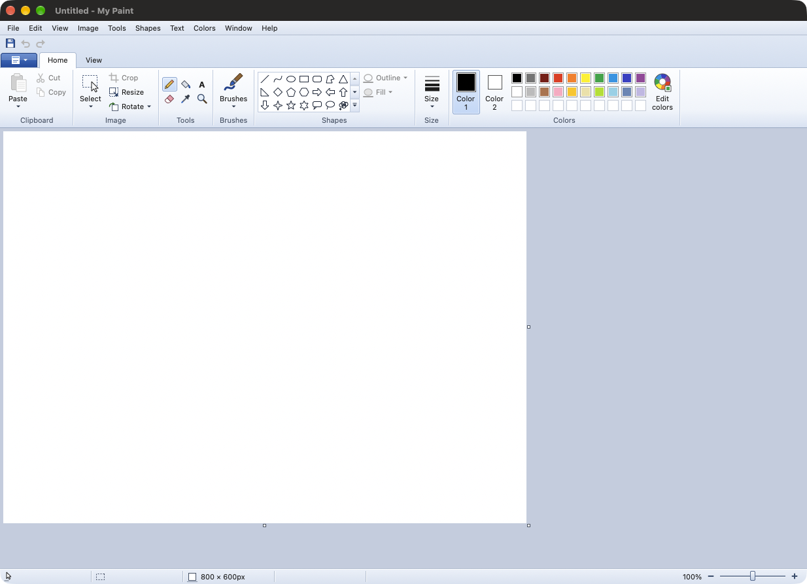

# My Suite

[Português (Brasil)](../../README.md) · **English** · [Español](es.md) · [Français](fr.md) · [Deutsch](de.md) · [Italiano](it.md) · [日本語](ja.md) · [한국어](ko.md)

Three simple, straightforward apps for macOS, with the menus and shortcuts you already know: a file manager, a text editor and an image editor. Each one has its own repository, version and download; this repository brings the three together in a single installer.

## Install

- **[Download for Apple Silicon (M-series)](https://github.com/leoars/my-suite/releases/download/1.0.1/My-Suite-1.0.1-arm64.pkg)**
- **[Download for Intel](https://github.com/leoars/my-suite/releases/download/1.0.1/My-Suite-1.0.1-x86_64.pkg)**

The installer brings My Explorer 1.0.1, My Notepad 1.0.2 and My Paint 1.0. Open it and, under **Customize**, choose which apps to install; all three come selected. It is signed with Developer ID and notarized by Apple, and speaks English, Portuguese, Spanish, French, German, Italian, Japanese and Korean.

Requires macOS 12 or later. My Explorer requires macOS 14 or later: on earlier versions it appears unselected and the other two are installed normally.

## My Explorer

A file manager with a folder tree, tabs, a command bar and several views, working with the Trash, volumes, iCloud and the Mac's apps.


- **Navigation:** a tree with the Mac's folders, favorite and recent folders, tabs with their own history, an address bar that turns into text when clicked, and a folder filter with wildcards (`*.pdf`).
- **Five views**, remembered per folder: Details, List, Small icons, Large icons and Gallery, with photo and video thumbnails.
- **File operations:** copy and move with progress and pause, undo, a Trash with Put Back, ZIP, Properties with folder sizes, and fast deletion of thousands of files.
- **Preview:** images, video, audio and PDF in the preview pane and in a viewer of its own.
- **And more:** text from images and PDFs (OCR), iCloud Drive status, Amazon S3, password-protected folders, Git and connecting to SMB servers.

Requires macOS 14 or later. [Learn more about My Explorer](https://github.com/leoars/my-explorer)

## My Notepad

A simple text editor: open a .txt file, write and save with the shortcuts you already know.


- **Truly plain text:** no spell checker, no automatic substitutions and no hidden formatting.
- **Find, Replace** and **Go To** a line by number.
- **Encodings** ANSI, UTF-8 and UTF-16, detected automatically, keeping the file's line endings.
- **Word wrap**, a choice of font and a status bar with line and column.
- **Page Setup and Print**, with header and footer, and the .txt journal with `.LOG`.

Requires macOS 12 or later. [Learn more about My Notepad](https://github.com/leoars/My-Notepad/blob/main/docs/readme/en.md)

## My Paint

A simple image editor: open an image, draw with pencils, brushes, shapes and text, and save as PNG, JPEG, BMP or GIF.



- **Tools:** pencil, eraser, fill with color, color picker, magnifier and text.
- **Nine brushes** and the **23 shapes** of the gallery, with outline and fill.
- **Colors:** Color 1 and Color 2, a 20-color palette and custom colors.
- **Selection**, rectangular and free-form, with cut, copy and paste between apps.
- **Image:** crop, resize, skew, rotate and flip.

Requires macOS 12 or later. [Learn more about My Paint](https://github.com/leoars/my-paint/blob/main/docs/readme/en.md)

## How the apps work together

- In My Explorer, double-clicking a text file opens My Notepad, and the context menu offers **Edit with My Notepad** and **Edit with My Paint**.
- The **About** window of each app leads to the other two.
- None depends on another: install only the ones you want.

## Updates

My Explorer checks for new versions by itself and installs the one you accept. My Notepad and My Paint are updated by installing the new version, with this installer or with each app's own.

## Building the installer

`build.sh` assembles the installer from the apps already released and notarized; nothing is compiled here. The suite's number is in `VERSION`.

```sh
DEVELOPER_ID_INSTALLER="Developer ID Installer: …" NOTARY_PROFILE=my-suite-notary ./build.sh
```

Distributed under the [Apache 2.0 license](../../LICENSE).
