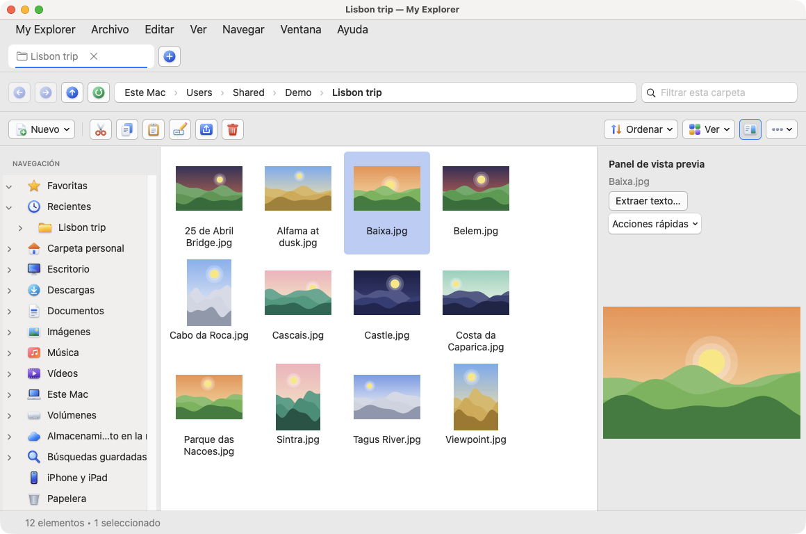
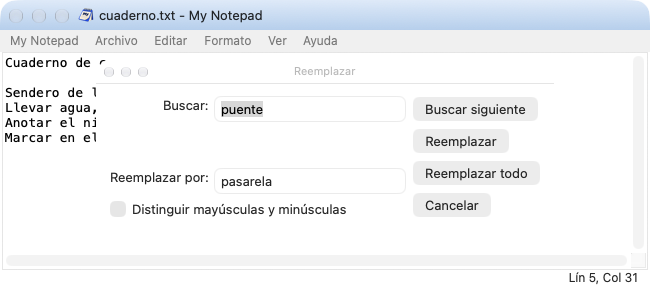
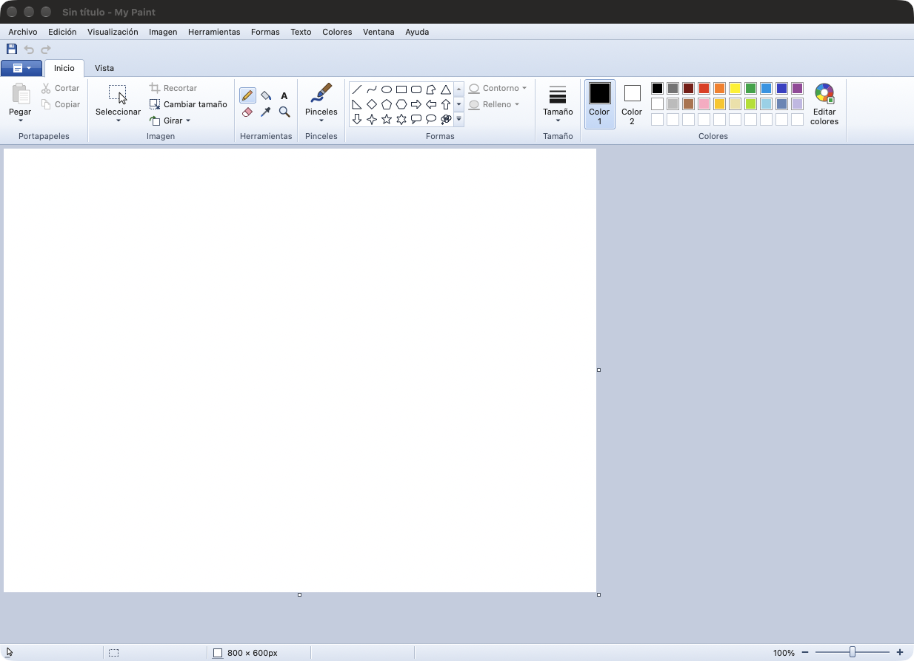

# My Suite

[Português (Brasil)](../../README.md) · [English](en.md) · **Español** · [Français](fr.md) · [Deutsch](de.md) · [Italiano](it.md) · [日本語](ja.md) · [한국어](ko.md)

Tres aplicaciones para macOS sencillas y directas, con los menús y los atajos de siempre: un gestor de archivos, un editor de texto y un editor de imágenes. Cada una tiene su propio repositorio, su versión y su descarga; este repositorio reúne las tres en un solo instalador.

## Instalar

- **[Descargar para Apple Silicon (serie M)](https://github.com/leoars/my-suite/releases/download/1.0.1/My-Suite-1.0.1-arm64.pkg)**
- **[Descargar para Intel](https://github.com/leoars/my-suite/releases/download/1.0.1/My-Suite-1.0.1-x86_64.pkg)**

El instalador incluye My Explorer 1.0.1, My Notepad 1.0.2 y My Paint 1.0. Ábrelo y, en **Personalizar**, elige qué aplicaciones instalar; las tres vienen seleccionadas. Está firmado con Developer ID y notarizado por Apple, y está disponible en inglés, portugués, español, francés, alemán, italiano, japonés y coreano.

Requiere macOS 12 o posterior. My Explorer requiere macOS 14 o posterior: en versiones anteriores aparece sin seleccionar y las otras dos se instalan con normalidad.

## My Explorer

Un gestor de archivos con árbol de carpetas, pestañas, barra de comandos y varias vistas, integrado con la Papelera, los volúmenes, iCloud y las aplicaciones del Mac.



- **Navegación:** árbol con las carpetas del Mac, carpetas favoritas y recientes, pestañas con su propio historial, una barra de direcciones que se convierte en texto al hacer clic y un filtro de la carpeta con comodines (`*.pdf`).
- **Cinco vistas**, recordadas por carpeta: Detalles, Lista, Iconos pequeños, Iconos grandes y Galería, con miniaturas de fotos y vídeos.
- **Operaciones con archivos:** copiar y mover con progreso y pausa, deshacer, Papelera con Restaurar, ZIP, Propiedades con el tamaño de las carpetas y eliminación rápida de miles de archivos.
- **Vista previa:** imágenes, vídeo, audio y PDF en el panel de vista previa y en un visor propio.
- **Y más:** texto de imágenes y PDF (OCR), estado de iCloud Drive, Amazon S3, carpetas protegidas con contraseña, Git y conexión a servidores SMB.

Requiere macOS 14 o posterior. [Más información sobre My Explorer](https://github.com/leoars/my-explorer/blob/main/README.es.md)

## My Notepad

Un editor de texto sencillo: abre un archivo .txt, escribe y guarda con los atajos que ya conoces.



- **Texto plano de verdad:** sin corrector ortográfico, sin sustituciones automáticas y sin formato oculto.
- **Buscar, Reemplazar** e **Ir a** una línea por su número.
- **Codificaciones** ANSI, UTF-8 y UTF-16, detectadas automáticamente, conservando los finales de línea del archivo.
- **Ajuste de línea**, elección de la fuente y una barra de estado con la línea y la columna.
- **Configurar página e Imprimir**, con encabezado y pie de página, y el diario en .txt con `.LOG`.

Requiere macOS 12 o posterior. [Más información sobre My Notepad](https://github.com/leoars/My-Notepad/blob/main/docs/readme/es.md)

## My Paint

Un editor de imágenes sencillo: abre una imagen, dibuja con lápices, pinceles, formas y texto, y guarda en PNG, JPEG, BMP o GIF.



- **Herramientas:** lápiz, borrador, rellenar con color, selector de color, lupa y texto.
- **Nueve pinceles** y las **23 formas** de la galería, con contorno y relleno.
- **Colores:** Color 1 y Color 2, una paleta de 20 colores y colores personalizados.
- **Selección**, rectangular y libre, con cortar, copiar y pegar entre aplicaciones.
- **Imagen:** recortar, cambiar tamaño, inclinar, girar y voltear.

Requiere macOS 12 o posterior. [Más información sobre My Paint](https://github.com/leoars/my-paint/blob/main/docs/readme/es.md)

## Cómo funcionan juntas

- En My Explorer, el doble clic en un archivo de texto abre My Notepad, y el menú contextual ofrece **Editar con My Notepad** y **Editar con My Paint**.
- La ventana **Acerca de** de cada aplicación lleva a las otras dos.
- Ninguna depende de otra: instala solo las que quieras.

## Actualizaciones

My Explorer busca nuevas versiones por sí mismo e instala la que aceptes. My Notepad y My Paint se actualizan instalando la nueva versión, con este instalador o con el de cada aplicación.

## Generar el instalador

`build.sh` monta el instalador a partir de las aplicaciones ya publicadas y notarizadas; aquí no se compila nada. El número de la suite está en `VERSION`.

```sh
DEVELOPER_ID_INSTALLER="Developer ID Installer: …" NOTARY_PROFILE=my-suite-notary ./build.sh
```

Distribuido bajo la [licencia Apache 2.0](../../LICENSE).
