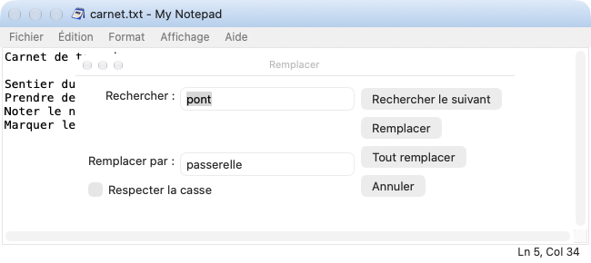
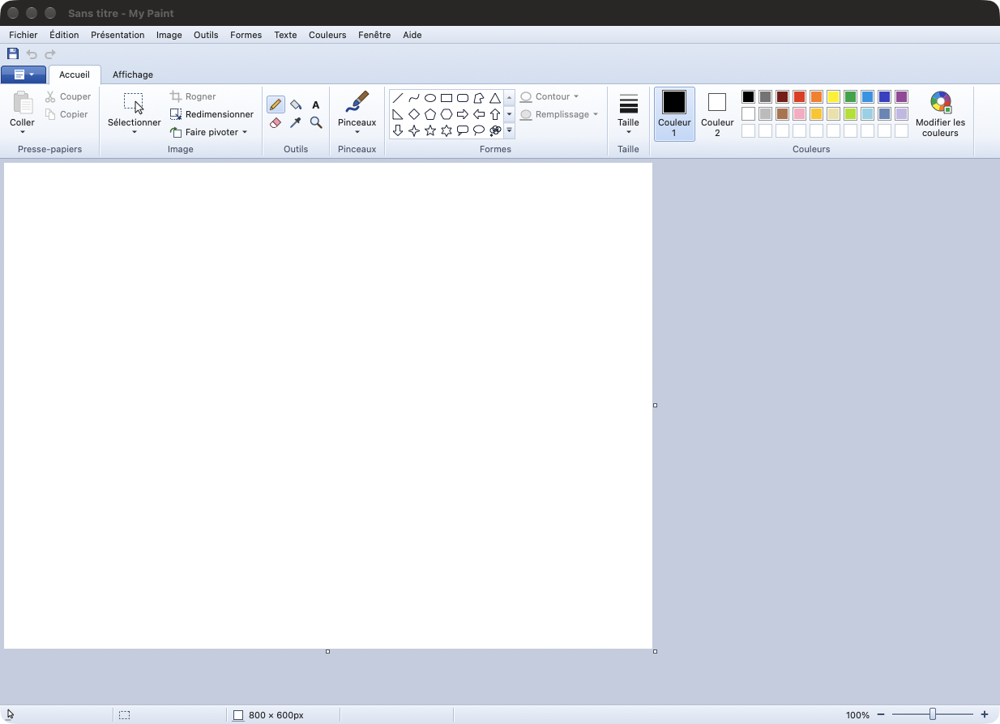

# My Suite

[Português (Brasil)](../../README.md) · [English](en.md) · [Español](es.md) · **Français** · [Deutsch](de.md) · [Italiano](it.md) · [日本語](ja.md) · [한국어](ko.md)

Trois applications pour macOS, simples et directes, avec les menus et les raccourcis que vous connaissez déjà : un gestionnaire de fichiers, un éditeur de texte et un éditeur d’images. Chacune a son propre dépôt, sa version et son téléchargement ; ce dépôt réunit les trois dans un seul programme d’installation.

## Installer

- **[Télécharger pour Apple Silicon (série M)](https://github.com/leoars/my-suite/releases/download/1.0.1/My-Suite-1.0.1-arm64.pkg)**
- **[Télécharger pour Intel](https://github.com/leoars/my-suite/releases/download/1.0.1/My-Suite-1.0.1-x86_64.pkg)**

Le programme d’installation contient My Explorer 1.0.1, My Notepad 1.0.2 et My Paint 1.0. Ouvrez-le et, dans **Personnaliser**, choisissez les applications à installer ; les trois sont cochées. Il est signé avec Developer ID et notarié par Apple, et il est disponible en anglais, portugais, espagnol, français, allemand, italien, japonais et coréen.

Nécessite macOS 12 ou ultérieur. My Explorer nécessite macOS 14 ou ultérieur : sur les versions antérieures, il apparaît décoché et les deux autres s’installent normalement.

## My Explorer

Un gestionnaire de fichiers avec arborescence des dossiers, onglets, barre de commandes et plusieurs affichages, intégré à la Corbeille, aux volumes, à iCloud et aux applications du Mac.


- **Navigation :** une arborescence avec les dossiers du Mac, des dossiers favoris et récents, des onglets avec leur propre historique, une barre d’adresse qui devient du texte quand vous cliquez dessus et un filtre du dossier avec caractères génériques (`*.pdf`).
- **Cinq affichages**, mémorisés pour chaque dossier : Détails, Liste, Petites icônes, Grandes icônes et Galerie, avec des vignettes pour les photos et les vidéos.
- **Opérations sur les fichiers :** copie et déplacement avec progression et pause, annulation, Corbeille avec Remettre, ZIP, Propriétés avec la taille des dossiers et suppression rapide de milliers de fichiers.
- **Aperçu :** images, vidéo, audio et PDF dans le volet d’aperçu et dans une visionneuse dédiée.
- **Et aussi :** texte des images et des PDF (OCR), état d’iCloud Drive, Amazon S3, dossiers protégés par mot de passe, Git et connexion aux serveurs SMB.

Nécessite macOS 14 ou ultérieur. [En savoir plus sur My Explorer](https://github.com/leoars/my-explorer/blob/main/README.fr.md)

## My Notepad

Un éditeur de texte simple : ouvrez un fichier .txt, écrivez et enregistrez avec les raccourcis que vous connaissez déjà.



- **Du vrai texte brut :** pas de correcteur orthographique, pas de substitutions automatiques, pas de mise en forme cachée.
- **Rechercher, Remplacer** et **Atteindre** une ligne d’après son numéro.
- **Encodages** ANSI, UTF-8 et UTF-16, détectés automatiquement, en conservant les fins de ligne du fichier.
- **Retour automatique à la ligne**, choix de la police et une barre d’état avec la ligne et la colonne.
- **Mise en page et Imprimer**, avec en-tête et pied de page, et le journal en .txt avec `.LOG`.

Nécessite macOS 12 ou ultérieur. [En savoir plus sur My Notepad](https://github.com/leoars/My-Notepad/blob/main/docs/readme/fr.md)

## My Paint

Un éditeur d’images simple : ouvrez une image, dessinez avec des crayons, des pinceaux, des formes et du texte, et enregistrez en PNG, JPEG, BMP ou GIF.



- **Outils :** crayon, gomme, remplir avec la couleur, pipette, loupe et texte.
- **Neuf pinceaux** et les **23 formes** de la galerie, avec contour et remplissage.
- **Couleurs :** Couleur 1 et Couleur 2, une palette de 20 couleurs et des couleurs personnalisées.
- **Sélection**, rectangulaire et libre, avec couper, copier et coller entre applications.
- **Image :** rogner, redimensionner, incliner, faire pivoter et retourner.

Nécessite macOS 12 ou ultérieur. [En savoir plus sur My Paint](https://github.com/leoars/my-paint/blob/main/docs/readme/fr.md)

## Comment les applications fonctionnent ensemble

- Dans My Explorer, un double-clic sur un fichier texte ouvre My Notepad, et le menu contextuel propose **Modifier avec My Notepad** et **Modifier avec My Paint**.
- La fenêtre **À propos** de chaque application mène aux deux autres.
- Aucune ne dépend d’une autre : installez seulement celles que vous voulez.

## Mises à jour

My Explorer recherche lui-même les nouvelles versions et installe celle que vous acceptez. My Notepad et My Paint se mettent à jour en installant la nouvelle version, avec ce programme d’installation ou avec celui de chaque application.

## Créer le programme d’installation

`build.sh` assemble le programme d’installation à partir des applications déjà publiées et notariées ; rien n’est compilé ici. Le numéro de la suite se trouve dans `VERSION`.

```sh
DEVELOPER_ID_INSTALLER="Developer ID Installer: …" NOTARY_PROFILE=my-suite-notary ./build.sh
```

Distribué sous la [licence Apache 2.0](../../LICENSE).
