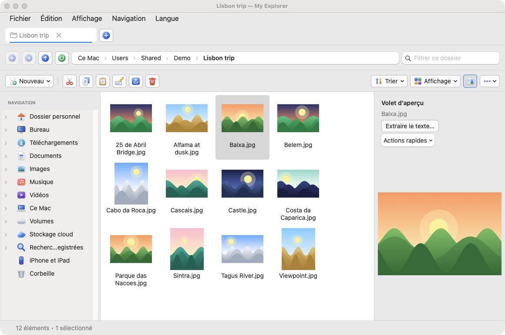
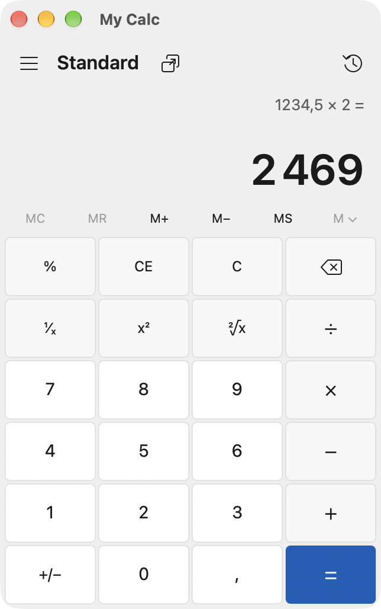

# My Suite

[Português (Brasil)](../../README.md) · [English](en.md) · [Español](es.md) · **Français** · [Deutsch](de.md) · [Italiano](it.md) · [日本語](ja.md) · [한국어](ko.md)

Quatre applications pour macOS, simples et directes, avec les menus et les raccourcis que vous connaissez déjà : un gestionnaire de fichiers, un éditeur de texte, un éditeur d’images et une calculatrice. Chacune a son propre dépôt, sa version et son téléchargement ; ce dépôt réunit les quatre dans un seul programme d’installation.

## Installer

- **[Télécharger pour Apple Silicon (série M)](https://github.com/leoars/my-suite/releases/download/1.0.8/My-Suite-1.0.8-arm64.pkg)**
- **[Télécharger pour Intel](https://github.com/leoars/my-suite/releases/download/1.0.8/My-Suite-1.0.8-x86_64.pkg)**

Le programme d’installation contient My Explorer 1.0.5, My Notepad 1.0.7, My Paint 1.0.2 et My Calc 1.0. Ouvrez-le et, dans **Personnaliser**, choisissez les applications à installer ; les quatre sont cochées. Il est signé avec Developer ID et notarié par Apple, et il est disponible en anglais, portugais, espagnol, français, allemand, italien, japonais et coréen.

Nécessite macOS 12 ou ultérieur. My Explorer nécessite macOS 14 ou ultérieur : sur les versions antérieures, il apparaît décoché et les trois autres s’installent normalement.

## My Explorer

Un gestionnaire de fichiers avec arborescence des dossiers, onglets, barre de commandes et plusieurs affichages, intégré à la Corbeille, aux volumes, à iCloud et aux applications du Mac.



### Navigation

- Arborescence des dossiers avec Dossier personnel, Bureau, Documents, Téléchargements, Ce Mac, Volumes, Stockage cloud, Recherches enregistrées, iPhone et iPad et Corbeille, ainsi que les dossiers favoris et récents.
- Des onglets, chacun avec son historique, sa sélection, son tri et son filtre.
- Une seule barre d’adresse : le fil des dossiers est cliquable et se transforme en chemin au format texte quand vous cliquez dessus, avec des suggestions pendant la saisie.
- **Précédent**, **Suivant**, **Dossier parent** et **Actualiser** ; la liste s’actualise d’elle-même quand les fichiers changent en dehors de l’application.
- **Filtrer ce dossier** par nom, avec caractères génériques (`*.pdf`), et **Rechercher des fichiers…** par nom, extension, contenu, date et étiquettes, dans ce dossier ou sur tout le Mac. Les recherches peuvent être enregistrées dans l’arborescence.

### Affichages

- Cinq modes, mémorisés pour chaque dossier : **Détails**, **Liste**, **Petites icônes**, **Grandes icônes** et **Galerie**, avec des vignettes pour les photos et les vidéos.
- **Trier** par nom, date de modification, type ou taille ; en Détails, faites glisser les en-têtes pour modifier l’ordre et la largeur des colonnes.
- **Éléments masqués** et **Extensions de noms de fichiers** dans le menu Affichage.

### Opérations sur les fichiers

- Barre de commandes avec **Nouveau**, **Couper**, **Copier**, **Coller**, **Renommer**, **Partager** et **Supprimer**.
- Copie et déplacement avec progression, pause et vérification. Si le nom existe déjà : remplacer, fusionner les dossiers, conserver les deux ou ignorer.
- **Annuler** pour un maximum de 20 copies, déplacements et suppressions de la session, et renommage sur place avec F2.
- Corbeille dans l’arborescence, avec **Remettre**, **Supprimer définitivement…** et **Vider la corbeille…**.
- **Compresser en ZIP** et **Extraire le ZIP**, glisser-déposer entre applications, **Ouvrir avec…**, **Partager…** (y compris par AirDrop), étiquettes du Finder et **Copier le chemin**.
- **Propriétés** avec le chemin et les autorisations ; pour un volume, capacité totale, utilisée et libre.
- Actions rapides pour les images et les PDF : faire pivoter, convertir en JPEG ou PNG et créer un PDF.

### Aperçu et multimédia

- Le volet d’aperçu affiche les images, la vidéo et l’audio avec des commandes de lecture, les PDF avec le défilement des pages, le Markdown mis en forme (avec tableaux, listes de tâches et coloration du code, ou la source) et les autres types grâce à Coup d’œil (Quick Look).
- Une visionneuse dédiée ouvre les images, les vidéos et les fichiers audio, passe d’un fichier du dossier à l’autre avec les flèches et zoome de 1 % à 800 %. Les images animées (WebP, GIF, APNG) sont lues.

### Reconnaissance de texte (OCR)

- **Extraire le texte…** des images et des PDF numérisés, avec détection de la langue, pour le copier ou l’enregistrer au format TXT.
- **Créer un PDF consultable…**, un fichier à la fois ou par lot de 50 au maximum. Tout est traité sur le Mac lui-même.

### iCloud et stockage cloud

- État de chaque élément d’iCloud Drive dans la liste (sur le Mac, en ligne uniquement, en cours de téléchargement ou d’envoi), téléchargement en un clic avec la progression sur l’icône, et **Supprimer le téléchargement de ce Mac**.
- Téléchargement de tout un dossier ou de la seule sélection, avec une réserve d’espace disque qui n’est jamais entamée.
- Amazon S3 : connecter un bucket, parcourir, copier entre le Mac et le cloud, déplacer, créer des dossiers et supprimer, avec les identifiants dans Trousseaux d’accès de macOS. Azure Blob Storage et Google Cloud Storage sont expérimentaux.

### Dossiers protégés, Git et réseau

- **Protéger le dossier…** place un dossier dans un coffre chiffré en AES-256, ouvert par mot de passe, qui se verrouille de lui-même au verrouillage de la session, à la mise en veille et à la fermeture de l’application.
- Git : marques d’état sur les fichiers, la branche dans la barre d’état, **Voir les modifications**, **Voir l’historique**, commit, changement de branche, fetch, pull et push, avec le Git installé sur le Mac.
- Éjecter des disques, **Se connecter au serveur…** en SMB et importer les photos d’un iPhone ou d’un iPad.

### Options et raccourcis

- Restaurer les onglets ou le dernier dossier à l’ouverture, tailles de police distinctes pour l’arborescence, la liste, les menus et les barres, et thème clair ou sombre, selon le système.
- Les raccourcis avec Ctrl fonctionnent comme vous les connaissez déjà (Ctrl+C, Ctrl+V, F2, F5, Ctrl+T pour un nouvel onglet) ; leurs équivalents avec ⌘ aussi.
- Recherche les nouvelles versions à l’ouverture et installe celle que vous acceptez.
- Expérimental et désactivé par défaut : une ligne de commande et un serveur MCP permettent à un assistant IA de travailler dans les dossiers que vous autorisez, pendant 24 heures.

Nécessite macOS 14 ou ultérieur. [En savoir plus sur My Explorer](https://github.com/leoars/my-explorer/blob/main/README.fr.md)

## My Notepad

Un éditeur de texte simple : ouvrez un fichier .txt, écrivez et enregistrez avec les raccourcis que vous connaissez déjà.


- **Du vrai texte brut :** pas de correcteur orthographique, pas de substitutions automatiques, pas de mise en forme cachée.
- **Fichier :** Nouveau, Ouvrir, Ouvrir l’élément récent (les dix derniers fichiers), Enregistrer et Enregistrer sous, avec un avertissement avant de perdre des modifications. À la première ouverture, il propose de devenir l’éditeur par défaut des fichiers .txt.
- **Fenêtres et session :** chaque document dans sa fenêtre, avec **Nouvelle fenêtre**. Ce qui n’a pas été enregistré est conservé et revient à la prochaine ouverture, sans question à la fermeture ; **Réglages…** permet de la rétablir.
- **Rechercher** avec le choix de la direction et le respect de la casse, **Remplacer** et **Tout remplacer** dans une fenêtre qui reste ouverte pendant que vous travaillez, et **Atteindre** une ligne d’après son numéro.
- **Encodages :** ouvre et enregistre en ANSI (CP-1252), UTF-8, UTF-16 LE et UTF-16 BE, avec détection automatique, et conserve les fins de ligne CRLF, LF ou CR du fichier.
- **Affichage :** retour automatique à la ligne, choix de la police, taille de la police au clavier ou avec Ctrl et la molette de la souris, et barre d’état avec la ligne et la colonne.
- **Imprimer :** Mise en page avec en-tête, pied de page (`&f`, `&p`, `&d`, `&t`), marges, papier et orientation.
- **Heure/Date** avec F5 et le journal en .txt : un fichier qui commence par `.LOG` reçoit l’heure et la date à la fin à chaque ouverture.
- **Les raccourcis de toujours :** Ctrl+S, Ctrl+F, F3, Ctrl+H, Ctrl+G, Ctrl+Backspace et les autres, ainsi que leurs équivalents avec ⌘.

Nécessite macOS 12 ou ultérieur. [En savoir plus sur My Notepad](https://github.com/leoars/My-Notepad/blob/main/docs/readme/fr.md)

## My Paint

Un éditeur d’images simple : ouvrez une image, dessinez avec des crayons, des pinceaux, des formes et du texte, et enregistrez en PNG, JPEG, BMP ou GIF.


- **Fichier :** ouvre et enregistre les formats PNG, JPEG, BMP, GIF et TIFF, avec Images récentes, Propriétés de l’image et Définir comme fond d’écran.
- **Outils :** crayon, gomme, remplir avec la couleur, pipette, loupe et texte ; le bouton gauche peint avec Couleur 1 et le bouton droit avec Couleur 2.
- **Neuf pinceaux**, dont les pinceaux calligraphiques, l’aérographe, le pinceau à huile, le pastel et le pinceau aquarelle, chacun en quatre tailles.
- **23 formes** de la galerie, avec contour et remplissage en couleur unie ou en texture, ajustables avec les poignées avant de les valider.
- **Couleurs :** une palette de 20 couleurs, des couleurs personnalisées et Modifier les couleurs par teinte, saturation et luminosité ou par RVB.
- **Sélection** rectangulaire, libre et transparente ; déplacer, dupliquer, étirer et coller entre applications.
- **Image :** rogner, redimensionner et incliner, faire pivoter, retourner et inverser les couleurs, sur la sélection ou l’image entière.
- **Texte** avec police, taille, gras, italique, souligné et barré, et compatibilité avec les méthodes de saisie du japonais et du coréen.
- **Affichage et impression :** zoom de 12,5 % à 800 %, règles, quadrillage, plein écran, miniature, Aperçu avant impression et annulation sur 50 niveaux.

Nécessite macOS 12 ou ultérieur. [En savoir plus sur My Paint](https://github.com/leoars/my-paint/blob/main/docs/readme/fr.md)

## My Calc

Une calculatrice simple : faites vos calculs en mode standard, scientifique ou programmeur, avec les touches et les raccourcis que vous connaissez déjà.



- **Standard :** les quatre opérations, pourcentage, inverse, carré et racine carrée, dans l’ordre où les touches sont pressées.
- **Scientifique :** priorité des opérateurs et parenthèses ; trigonométrie en degrés, radians ou grades ; puissances, logarithmes et factorielle.
- **Programmeur :** le nombre en HEX, DEC, OCT et BIN à la fois, mots de 8 à 64 bits, opérations bit à bit et un panneau avec les 64 bits.
- **Mémoire et historique :** MS, MR, M+, M− et MC avec la liste des nombres mémorisés, et l’historique des calculs ; copier et coller des nombres ou des calculs entiers.
- **Arithmétique décimale** sur 32 chiffres significatifs : 0,1 + 0,2 donne 0,3.
- Apparence claire ou sombre selon le système, fenêtre redimensionnable et **Toujours visible**.

Nécessite macOS 12 ou ultérieur. [En savoir plus sur My Calc](https://github.com/leoars/my-calc/blob/main/docs/readme/fr.md)

## Comment les applications fonctionnent ensemble

- Dans My Explorer, un double-clic sur un fichier texte ouvre My Notepad, et le menu contextuel propose **Modifier avec My Notepad** et **Modifier avec My Paint**.
- La fenêtre **À propos** de chacune des quatre mène aux trois autres.
- Aucune ne dépend d’une autre : installez seulement celles que vous voulez.

## Mises à jour

Les quatre applications recherchent les nouvelles versions à l’ouverture et installent celle que vous acceptez ; chacune propose **Rechercher les mises à jour au démarrage** dans ses Options ou Réglages, avec **Vérifier maintenant**. My Notepad et My Paint le font depuis les versions 1.0.5 et 1.0.1 : une fois la mise à jour acceptée, le nouveau programme d’installation est vérifié et s’ouvre dans le programme d’installation de macOS. Avec une version antérieure, faites une fois la mise à jour avec ce programme d’installation ou avec celui de chaque application.

## Créer le programme d’installation

`build.sh` assemble le programme d’installation à partir des applications déjà publiées et notariées ; rien n’est compilé ici. Le numéro de la suite se trouve dans `VERSION`.

```sh
DEVELOPER_ID_INSTALLER="Developer ID Installer: …" NOTARY_PROFILE=my-suite-notary ./build.sh
```

Distribué sous la [licence Apache 2.0](../../LICENSE).
