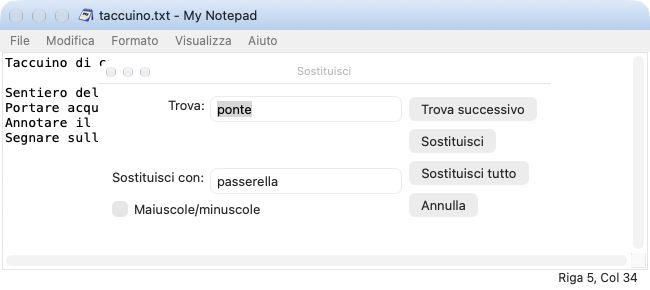
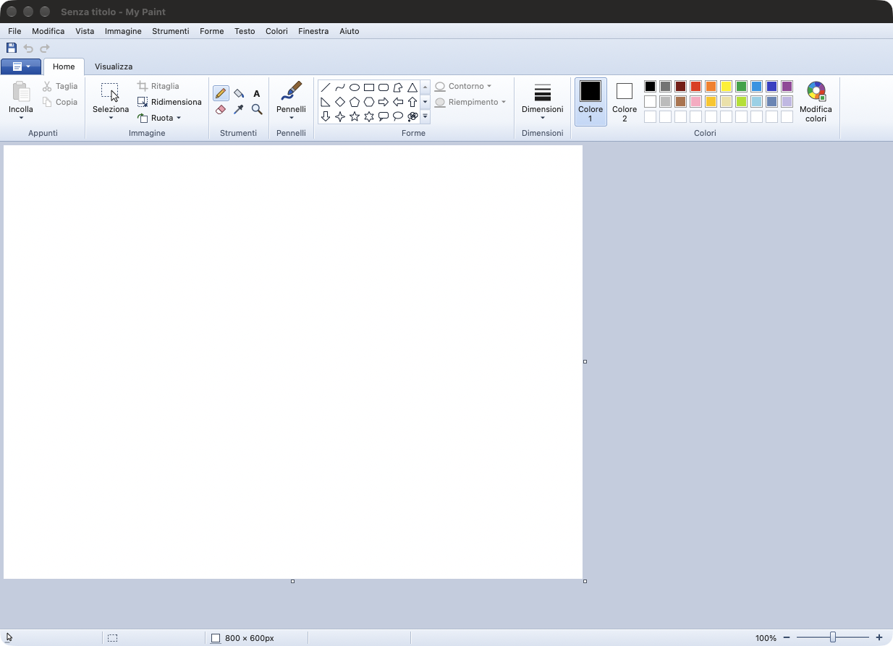

# My Suite

[Português (Brasil)](../../README.md) · [English](en.md) · [Español](es.md) · [Français](fr.md) · [Deutsch](de.md) · **Italiano** · [日本語](ja.md) · [한국어](ko.md)

Tre app per macOS semplici e dirette, con i menu e le scorciatoie che conosci già: un gestore di file, un editor di testo e un editor di immagini. Ognuna ha il proprio repository, la propria versione e il proprio download; questo repository le riunisce in un unico programma di installazione.

## Installare

- **[Scarica per Apple Silicon (serie M)](https://github.com/leoars/my-suite/releases/download/1.0.1/My-Suite-1.0.1-arm64.pkg)**
- **[Scarica per Intel](https://github.com/leoars/my-suite/releases/download/1.0.1/My-Suite-1.0.1-x86_64.pkg)**

Il programma di installazione include My Explorer 1.0.1, My Notepad 1.0.2 e My Paint 1.0. Aprilo e, in **Personalizza**, scegli quali app installare; sono selezionate tutte e tre. È firmato con Developer ID e autenticato da Apple tramite notarizzazione, ed è disponibile in inglese, portoghese, spagnolo, francese, tedesco, italiano, giapponese e coreano.

Richiede macOS 12 o successivo. My Explorer richiede macOS 14 o successivo: nelle versioni precedenti compare non selezionato e le altre due vengono installate normalmente.

## My Explorer

Un gestore di file con albero delle cartelle, schede, barra dei comandi e diverse viste, che funziona con il Cestino, i volumi, iCloud e le app del Mac.


- **Navigazione:** un albero con le cartelle del Mac, cartelle preferite e recenti, schede con la propria cronologia, una barra degli indirizzi che diventa testo quando ci fai clic e un filtro della cartella con caratteri jolly (`*.pdf`).
- **Cinque viste**, ricordate per ogni cartella: Dettagli, Elenco, Icone piccole, Icone grandi e Galleria, con le miniature di foto e video.
- **Operazioni sui file:** copia e spostamento con avanzamento e pausa, annullamento, Cestino con Ripristina, ZIP, Proprietà con le dimensioni delle cartelle ed eliminazione rapida di migliaia di file.
- **Anteprima:** immagini, video, audio e PDF nel riquadro di anteprima e in un visualizzatore dedicato.
- **E altro ancora:** testo da immagini e PDF (OCR), stato di iCloud Drive, Amazon S3, cartelle protette da password, Git e connessione a server SMB.

Richiede macOS 14 o successivo. [Scopri di più su My Explorer](https://github.com/leoars/my-explorer/blob/main/README.it.md)

## My Notepad

Un editor di testo semplice: apri un file .txt, scrivi e salva con le scorciatoie che conosci già.



- **Testo semplice per davvero:** niente correttore ortografico, niente sostituzioni automatiche e niente formattazione nascosta.
- **Trova**, **Sostituisci** e **Vai a** una riga indicandone il numero.
- **Codifiche** ANSI, UTF-8 e UTF-16, rilevate automaticamente, mantenendo le terminazioni di riga del file.
- **A capo automatico**, scelta del carattere e barra di stato con riga e colonna.
- **Imposta pagina e Stampa**, con intestazione e piè di pagina, e il diario in .txt con `.LOG`.

Richiede macOS 12 o successivo. [Scopri di più su My Notepad](https://github.com/leoars/My-Notepad/blob/main/docs/readme/it.md)

## My Paint

Un editor di immagini semplice: apri un’immagine, disegna con matite, pennelli, forme e testo e salva in PNG, JPEG, BMP o GIF.



- **Strumenti:** matita, gomma, riempi con colore, selettore colore, lente e testo.
- **Nove pennelli** e le **23 forme** della galleria, con contorno e riempimento.
- **Colori:** Colore 1 e Colore 2, una tavolozza di 20 colori e colori personalizzati.
- **Selezione** rettangolare e a mano libera, con taglia, copia e incolla tra le app.
- **Immagine:** ritaglia, ridimensiona, inclina, ruota e capovolgi.

Richiede macOS 12 o successivo. [Scopri di più su My Paint](https://github.com/leoars/my-paint/blob/main/docs/readme/it.md)

## Come funzionano insieme le app

- In My Explorer, il doppio clic su un file di testo apre My Notepad, e il menu contestuale offre **Modifica con My Notepad** e **Modifica con My Paint**.
- La finestra **Informazioni su** di ciascuna app porta alle altre due.
- Nessuna dipende da un’altra: installa solo quelle che vuoi.

## Aggiornamenti

My Explorer cerca da solo le nuove versioni e installa quella che accetti. My Notepad e My Paint si aggiornano installando la nuova versione, con questo programma di installazione o con quello di ciascuna app.

## Creare il programma di installazione

`build.sh` assembla il programma di installazione a partire dalle app già pubblicate e notarizzate; qui non si compila nulla. Il numero della suite si trova in `VERSION`.

```sh
DEVELOPER_ID_INSTALLER="Developer ID Installer: …" NOTARY_PROFILE=my-suite-notary ./build.sh
```

Distribuito con [licenza Apache 2.0](../../LICENSE).
