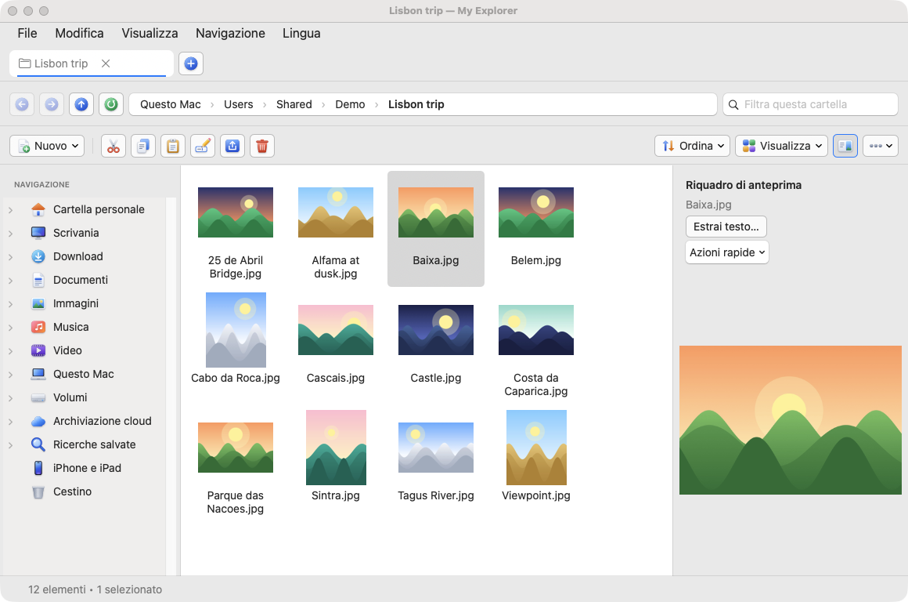

# My Suite

[Português (Brasil)](../../README.md) · [English](en.md) · [Español](es.md) · [Français](fr.md) · [Deutsch](de.md) · **Italiano** · [日本語](ja.md) · [한국어](ko.md)

Tre app per macOS semplici e dirette, con i menu e le scorciatoie che conosci già: un gestore di file, un editor di testo e un editor di immagini. Ognuna ha il proprio repository, la propria versione e il proprio download; questo repository le riunisce in un unico programma di installazione.

## Installare

- **[Scarica per Apple Silicon (serie M)](https://github.com/leoars/my-suite/releases/download/1.0.3/My-Suite-1.0.3-arm64.pkg)**
- **[Scarica per Intel](https://github.com/leoars/my-suite/releases/download/1.0.3/My-Suite-1.0.3-x86_64.pkg)**

Il programma di installazione include My Explorer 1.0.2, My Notepad 1.0.4 e My Paint 1.0. Aprilo e, in **Personalizza**, scegli quali app installare; sono selezionate tutte e tre. È firmato con Developer ID e autenticato da Apple tramite notarizzazione, ed è disponibile in inglese, portoghese, spagnolo, francese, tedesco, italiano, giapponese e coreano.

Richiede macOS 12 o successivo. My Explorer richiede macOS 14 o successivo: nelle versioni precedenti compare non selezionato e le altre due vengono installate normalmente.

## My Explorer

Un gestore di file con albero delle cartelle, schede, barra dei comandi e diverse viste, che funziona con il Cestino, i volumi, iCloud e le app del Mac.



### Navigazione

- Albero delle cartelle con Cartella personale, Scrivania, Documenti, Download, Questo Mac, Volumi, Archiviazione cloud, Ricerche salvate, iPhone e iPad e Cestino, oltre alle cartelle preferite e recenti.
- Schede, ciascuna con cronologia, selezione, ordinamento e filtro propri.
- Una sola barra degli indirizzi: mostra il percorso delle cartelle su cui puoi fare clic e diventa il percorso in formato testo quando ci fai clic, con suggerimenti mentre scrivi.
- **Indietro**, **Avanti**, **Cartella superiore** e **Aggiorna**; l’elenco si aggiorna da solo quando i file cambiano dall’esterno.
- **Filtra questa cartella** per nome, con caratteri jolly (`*.pdf`), e **Cerca file…** per nome, estensione, contenuto, data e tag, in questa cartella o in tutto il Mac. Le ricerche si possono salvare nell’albero.

### Viste

- Cinque modalità, ricordate per ogni cartella: **Dettagli**, **Elenco**, **Icone piccole**, **Icone grandi** e **Galleria**, con le miniature di foto e video.
- **Ordina** per nome, data di modifica, tipo o dimensioni; in Dettagli, trascina le intestazioni per cambiare l’ordine e la larghezza delle colonne.
- **Elementi nascosti** ed **Estensioni nomi file** nel menu Visualizza.

### Operazioni sui file

- Barra dei comandi con **Nuovo**, **Taglia**, **Copia**, **Incolla**, **Rinomina**, **Condividi** ed **Elimina**.
- Copia e spostamento con avanzamento, pausa e verifica. Se il nome esiste già: sostituire, unire le cartelle, conservare entrambi o ignorare.
- **Annulla** per un massimo di 20 copie, spostamenti ed eliminazioni della sessione, e rinomina sul posto con F2.
- Cestino nell’albero, con **Ripristina**, **Elimina definitivamente…** e **Svuota cestino…**.
- **Comprimi in ZIP** ed **Estrai ZIP**, trascinamento tra le app, **Apri con…**, **Condividi…** (anche tramite AirDrop), tag del Finder e **Copia percorso**.
- **Proprietà** con percorso e permessi; su un volume, capacità totale, utilizzata e libera.
- Azioni rapide per immagini e PDF: ruotare, convertire in JPEG o PNG e creare un PDF.

### Anteprima e contenuti multimediali

- Il riquadro di anteprima mostra immagini, video e audio con i controlli di riproduzione, i PDF con lo scorrimento delle pagine, il Markdown formattato (con tabelle, elenchi di attività ed evidenziazione del codice, o il sorgente) e gli altri tipi tramite Visualizzazione rapida (Quick Look).
- Un visualizzatore dedicato apre immagini, video e audio, scorre i file della cartella con le frecce e ingrandisce dall’1% all’800%. Le immagini animate (WebP, GIF, APNG) vengono riprodotte.

### Riconoscimento del testo (OCR)

- **Estrai testo…** da immagini e PDF acquisiti da scanner, con rilevamento della lingua, per copiarlo o salvarlo come TXT.
- **Crea PDF ricercabile…**, un file alla volta o in blocco fino a 50. Tutto avviene sul Mac stesso.

### iCloud e archiviazione cloud

- Stato di ogni elemento di iCloud Drive nell’elenco (sul Mac, solo online, in scaricamento o in caricamento), download con un clic e avanzamento sull’icona, e **Rimuovi il download da questo Mac**.
- Scaricare tutto il contenuto di una cartella o solo la selezione, con una riserva di spazio su disco che non viene mai intaccata.
- Amazon S3: collegare un bucket, sfogliare, copiare tra il Mac e il cloud, spostare, creare cartelle ed eliminare, con le credenziali nel Portachiavi di macOS. Azure Blob Storage e Google Cloud Storage sono sperimentali.

### Cartelle protette, Git e rete

- **Proteggi cartella…** custodisce una cartella in una cassaforte cifrata con AES-256, che si apre con una password e si blocca da sola quando la sessione viene bloccata, quando il Mac va in stop e all’uscita.
- Git: indicatori di stato sui file, il branch nella barra di stato, **Visualizza modifiche**, **Visualizza cronologia**, commit, cambio di branch, fetch, pull e push, con il Git installato sul Mac.
- Espellere i dischi, **Connetti al server…** tramite SMB e importare foto da un iPhone o iPad.

### Opzioni e scorciatoie

- Ripristinare le schede o l’ultima cartella all’apertura, dimensioni dei caratteri separate per l’albero, l’elenco, i menu e le barre, e tema chiaro o scuro in base al sistema.
- Le scorciatoie con Ctrl funzionano come già le conosci (Ctrl+C, Ctrl+V, F2, F5, Ctrl+T per una nuova scheda), e lo stesso vale per le equivalenti con ⌘.
- Cerca nuove versioni all’apertura e installa quella che accetti.
- Sperimentale e disattivato per impostazione predefinita: una riga di comando e un server MCP permettono a un assistente IA di lavorare nelle cartelle che autorizzi, per 24 ore.

Richiede macOS 14 o successivo. [Scopri di più su My Explorer](https://github.com/leoars/my-explorer/blob/main/README.it.md)

## My Notepad

Un editor di testo semplice: apri un file .txt, scrivi e salva con le scorciatoie che conosci già.


- **Testo semplice per davvero:** niente correttore ortografico, niente sostituzioni automatiche e niente formattazione nascosta.
- **File:** Nuovo, Apri, Salva e Salva con nome, con un avviso prima di perdere le modifiche. Alla prima apertura propone di diventare l’editor predefinito dei file .txt.
- **Finestre e sessione:** ogni documento nella sua finestra, con **Nuova finestra**. Ciò che non è stato salvato viene conservato e torna alla prossima apertura, senza domande alla chiusura; in **Impostazioni…** puoi riattivare la domanda.
- **Trova** con la direzione e l’opzione per distinguere maiuscole e minuscole, **Sostituisci** e **Sostituisci tutto** in una finestra che resta aperta mentre lavori, e **Vai a** una riga indicandone il numero.
- **Codifiche:** apre e salva in ANSI (CP-1252), UTF-8, UTF-16 LE e UTF-16 BE, con rilevamento automatico, e mantiene le terminazioni di riga CRLF, LF o CR del file.
- **Visualizza:** a capo automatico, scelta del carattere, dimensione del carattere dalla tastiera o con Ctrl e la rotellina del mouse, e barra di stato con riga e colonna.
- **Stampa:** Imposta pagina con intestazione, piè di pagina (`&f`, `&p`, `&d`, `&t`), margini, carta e orientamento.
- **Ora/data** con F5 e il diario in .txt: un file che inizia con `.LOG` riceve ora e data in fondo a ogni apertura.
- **Le scorciatoie di sempre:** Ctrl+S, Ctrl+F, F3, Ctrl+H, Ctrl+G, Ctrl+Backspace e le altre, con le equivalenti con ⌘.

Richiede macOS 12 o successivo. [Scopri di più su My Notepad](https://github.com/leoars/My-Notepad/blob/main/docs/readme/it.md)

## My Paint

Un editor di immagini semplice: apri un’immagine, disegna con matite, pennelli, forme e testo e salva in PNG, JPEG, BMP o GIF.


- **File:** apre e salva PNG, JPEG, BMP, GIF e TIFF, con le immagini recenti, Proprietà immagine e Imposta come sfondo della scrivania.
- **Strumenti:** matita, gomma, riempi con colore, selettore colore, lente e testo; il pulsante sinistro dipinge con Colore 1 e il destro con Colore 2.
- **Nove pennelli**, tra cui i pennelli calligrafici, l’aerografo, il pennello a olio, il pastello a cera e il pennello ad acquerello, ciascuno in quattro dimensioni.
- **23 forme** della galleria, con contorno e riempimento a colore pieno o con texture, da regolare con le maniglie prima di confermarle.
- **Colori:** tavolozza di 20 colori, colori personalizzati e Modifica colori per tonalità, saturazione e luminosità oppure per RGB.
- **Selezione** rettangolare, a mano libera e trasparente; sposta, duplica, allunga e incolla tra le app.
- **Immagine:** ritaglia, ridimensiona e inclina, ruota, capovolgi e inverti colori, sulla selezione o sull’intera immagine.
- **Testo** con tipo e dimensione del carattere, grassetto, corsivo, sottolineato e barrato, e supporto dei metodi di input del giapponese e del coreano.
- **Visualizza e stampa:** zoom dal 12,5% all’800%, righelli, griglia, schermo intero, miniatura, Anteprima di stampa e Annulla con 50 livelli.

Richiede macOS 12 o successivo. [Scopri di più su My Paint](https://github.com/leoars/my-paint/blob/main/docs/readme/it.md)

## Come funzionano insieme le app

- In My Explorer, il doppio clic su un file di testo apre My Notepad, e il menu contestuale offre **Modifica con My Notepad** e **Modifica con My Paint**.
- La finestra **Informazioni su** di ciascuna app porta alle altre due.
- Nessuna dipende da un’altra: installa solo quelle che vuoi.

## Aggiornamenti

My Explorer cerca da solo le nuove versioni e installa quella che accetti. My Notepad e My Paint si aggiornano installando la nuova versione, con questo programma di installazione o con quello di ciascuna app.

## Creare il programma di installazione

`build.sh` assembla il programma di installazione a partire dalle app già pubblicate e notarizzate; qui non si compila nulla. Il numero della suite si trova in `VERSION`.

```sh
DEVELOPER_ID_INSTALLER="Developer ID Installer: …" NOTARY_PROFILE=my-suite-notary ./build.sh
```

Distribuito con [licenza Apache 2.0](../../LICENSE).
