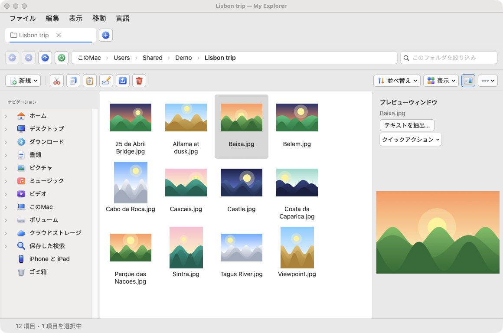
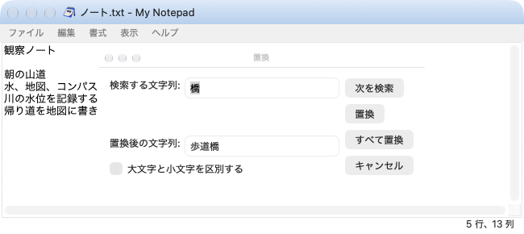
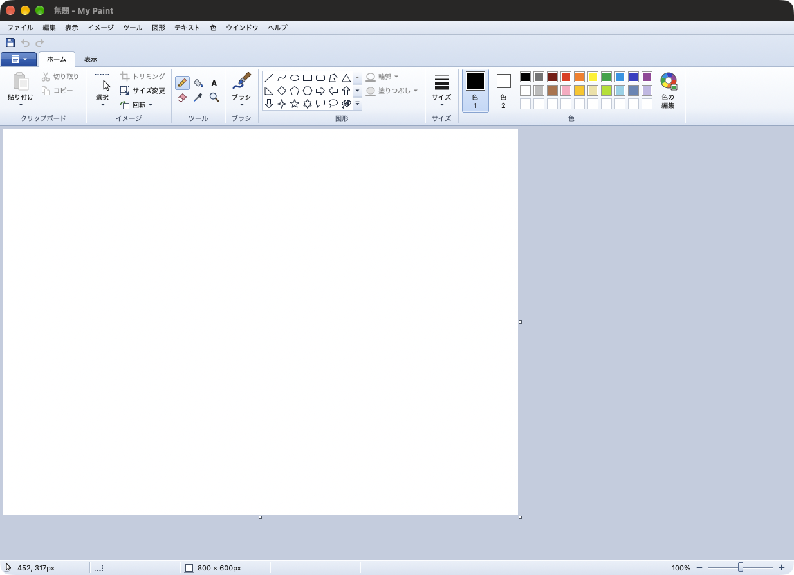

# My Suite

[Português (Brasil)](../../README.md) · [English](en.md) · [Español](es.md) · [Français](fr.md) · [Deutsch](de.md) · [Italiano](it.md) · **日本語** · [한국어](ko.md)

使い慣れたメニューとショートカットを備えた、シンプルでわかりやすい macOS 用アプリ 3 本です。ファイルマネージャ、テキストエディタ、画像エディタがそろっています。どのアプリにもそれぞれのリポジトリ、バージョン、ダウンロードがあり、このリポジトリは 3 本を 1 つのインストーラにまとめています。

## インストール

- **[Apple シリコン（M シリーズ）用をダウンロード](https://github.com/leoars/my-suite/releases/download/1.0.3/My-Suite-1.0.3-arm64.pkg)**
- **[Intel 用をダウンロード](https://github.com/leoars/my-suite/releases/download/1.0.3/My-Suite-1.0.3-x86_64.pkg)**

インストーラには My Explorer 1.0.2、My Notepad 1.0.4、My Paint 1.0 が入っています。インストーラを開き、**カスタマイズ** でインストールするアプリを選んでください。最初は 3 本すべてが選択されています。Developer ID で署名され、Apple の公証を受けており、英語、ポルトガル語、スペイン語、フランス語、ドイツ語、イタリア語、日本語、韓国語に対応しています。

macOS 12 以降が必要です。My Explorer には macOS 14 以降が必要で、それより前のバージョンでは選択されていない状態で表示され、ほかの 2 本は通常どおりインストールされます。

## My Explorer

フォルダツリー、タブ、コマンドバー、複数の表示モードを備え、ゴミ箱、ボリューム、iCloud、Mac のアプリと連携して使えるファイルマネージャです。



### ナビゲーション

- フォルダツリーには、ホーム、デスクトップ、書類、ダウンロード、このMac、ボリューム、クラウドストレージ、保存した検索、iPhone と iPad、ゴミ箱が並び、よく使うフォルダと最近使ったフォルダもあります。
- タブごとに、履歴、選択、並べ替え、フィルタを保持します。
- アドレスバーは 1 つだけです。クリックできるフォルダの階層を表示し、バーをクリックするとテキストのパスに切り替わり、入力中に候補を表示します。
- **戻る**、**進む**、**親フォルダへ**、**更新**。アプリの外でファイルが変更されると、一覧は自動的に更新されます。
- **このフォルダを絞り込み**で名前による絞り込み（ワイルドカード `*.pdf` も使えます）、**ファイルを検索…**で名前、拡張子、内容、日付、タグによる検索ができます。検索範囲はこのフォルダまたは Mac 全体から選べ、検索はツリーに保存できます。

### 表示と並べ替え

- 表示モードは **詳細**、**一覧**、**小アイコン**、**大アイコン**、**ギャラリー** の 5 種類で、フォルダごとに記憶されます。写真とビデオはサムネイルで表示されます。
- **並べ替え**は名前、更新日時、種類、サイズを基準に行えます。詳細では、列見出しをドラッグして列の順序や幅を変更できます。
- 「表示」メニューに **隠し項目** と **ファイル名拡張子** があります。

### ファイル操作

- コマンドバーに **新規**、**切り取り**、**コピー**、**貼り付け**、**名前の変更**、**共有**、**削除** があります。
- コピーと移動では、進行状況の表示、一時停止、検証ができます。同じ名前がすでにある場合は、置き換える、フォルダを統合する、両方を残す、スキップするから選べます。
- **取り消す**で、セッション中のコピー、移動、削除を 20 件まで取り消せます。F2 キーで、その場で名前を変更できます。
- ツリーにゴミ箱があり、**元に戻す**、**完全に削除…**、**ゴミ箱を空にする…** を使えます。
- **ZIP に圧縮** と **ZIP を展開**、ほかのアプリとの間のドラッグ＆ドロップ、**アプリケーションで開く…**、**共有…**（AirDrop を含む）、Finder タグ、**パスをコピー**。
- **プロパティ**でパスとアクセス権を確認できます。ボリュームでは、総容量、使用済み容量、空き容量を表示します。
- 画像と PDF のクイックアクション：回転、JPEG または PNG への変換、PDF の作成。

### プレビューウィンドウとメディアビューア

- プレビューウィンドウは、画像、再生コントロール付きのビデオとオーディオ、ページをめくれる PDF、書式付きの Markdown（表、タスクリスト、コードの色分け、またはソース）を表示し、そのほかの種類はクイックルックで表示します。
- ビューアは画像、ビデオ、オーディオを専用のウィンドウで開きます。矢印キーでフォルダ内のファイルを順に切り替えられ、1% から 800% まで拡大・縮小できます。アニメーション画像（WebP、GIF、APNG）は再生されます。

### テキスト認識（OCR）

- **テキストを抽出…** は、画像やスキャンした PDF から言語を自動判別してテキストを抽出し、コピーしたり TXT として保存したりできます。
- **検索可能な PDF を作成…** は、1 ファイルずつ、または最大 50 ファイルまで一括で実行できます。処理はすべて Mac 上で行われます。

### iCloud とクラウドストレージ

- iCloud Drive の各項目の状態（Mac 上にある、オンラインのみ、ダウンロード中、アップロード中）を一覧に表示します。1 回のクリックでダウンロードでき、進行状況がアイコンに表示されます。**この Mac からダウンロードを削除** も使えます。
- フォルダ全体、または選択した項目だけをダウンロードできます。確保しておくディスクの空き容量を割り込むことはありません。
- Amazon S3：バケットへの接続、閲覧、Mac とクラウドの間のコピー、移動、フォルダの作成、削除ができます。認証情報は macOS のキーチェーンに保存されます。Azure Blob Storage と Google Cloud Storage は試験的な機能です。

### 保護されたフォルダ、Git、ネットワーク

- **フォルダを保護…** は、AES-256 で暗号化され、パスワードで開く保管庫にフォルダを収めます。セッションのロック時、スリープ時、終了時に自動でロックされます。
- Git：ファイルに状態を示すマークを付け、ステータスバーにブランチを表示します。**変更を表示**、**履歴を表示**、コミット、ブランチの切り替え、フェッチ、プル、プッシュができます。Mac にインストールされている Git を使います。
- ディスクの取り出し、SMB での **サーバに接続…**、iPhone や iPad からの写真の読み込みができます。

### オプションとショートカット

- 起動時にタブまたは最後のフォルダを復元できます。フォントサイズはツリー、一覧、メニュー、バーごとに設定でき、テーマはシステムに合わせてライトまたはダークになります。
- Ctrl を使うショートカットは、おなじみのとおりに動作します（Ctrl+C、Ctrl+V、F2、F5、新しいタブを開く Ctrl+T）。⌘ を使う同等のショートカットも使えます。
- 起動時に新しいバージョンを確認し、承認したバージョンをインストールします。
- 試験的な機能で、既定ではオフ：コマンドラインと MCP サーバにより、許可したフォルダの中で AI アシスタントが 24 時間作業できます。

macOS 14 以降が必要です。[My Explorer の詳細を見る](https://github.com/leoars/my-explorer/blob/main/README.ja.md)

## My Notepad

シンプルなテキストエディタです。.txt ファイルを開き、書いて、使い慣れたショートカットで保存できます。



- **本当のプレーンテキスト：** スペルチェックも、自動置換も、隠れた書式もありません。
- **ファイル：** 新規作成、開く、保存、名前を付けて保存。変更が失われる前に確認します。初回起動時には、.txt ファイルの既定のエディタにするかどうかを選べます。
- **ウインドウとセッション：** 文書ごとに専用のウインドウ。**新規ウインドウ** もあります。保存していない内容は保持され、閉じるときに確認せず、次に開いたときに戻ります。**設定…** で確認を出すように戻せます。
- **検索** では検索方向と、大文字と小文字を区別するかどうかを指定できます。**置換** と **すべて置換** は作業中も開いたままにできるパネルで使え、行番号を指定する **指定行へ移動** もあります。
- **文字コード：** ANSI（CP-1252）、UTF-8、UTF-16 LE、UTF-16 BE での読み込みと保存に対応して自動で検出し、ファイルの改行形式（CRLF、LF、CR）はそのまま保ちます。
- **表示：** 右端で折り返す、フォントの選択、キーボードまたは Ctrl を押しながらマウスホイールを回しての文字サイズの変更、行と列を表示するステータス バー。
- **印刷：** ヘッダー、フッター（`&f`、`&p`、`&d`、`&t`）、余白、用紙、印刷の向きを設定できるページ設定。
- **時刻と日付** を F5 で挿入でき、.txt で作業日誌もつけられます。`.LOG` で始まるファイルは、開くたびに末尾に時刻と日付が追加されます。
- **おなじみのショートカット：** Ctrl+S、Ctrl+F、F3、Ctrl+H、Ctrl+G、Ctrl+Backspace など。⌘ を使う同等のショートカットも使えます。

macOS 12 以降が必要です。[My Notepad の詳細を見る](https://github.com/leoars/My-Notepad/blob/main/docs/readme/ja.md)

## My Paint

シンプルな画像エディタです。画像を開き、鉛筆、ブラシ、図形、テキストで描いて、PNG、JPEG、BMP、GIF で保存できます。



- **ファイル：** PNG、JPEG、BMP、GIF、TIFF の読み込みと保存に対応し、最近使った画像、イメージのプロパティ、デスクトップピクチャに設定を備えています。
- **ツール：** 鉛筆、消しゴム、塗りつぶし、色の選択、拡大鏡、テキスト。左ボタンは色 1、右ボタンは色 2 で描きます。
- **9 種類のブラシ**：カリグラフィ ブラシ、エアブラシ、油絵ブラシ、クレヨン、水彩ブラシなど。それぞれ 4 段階のサイズがあります。
- ギャラリーの **23 種類の図形**。輪郭と塗りつぶしは単色またはテクスチャから選べ、確定する前にハンドルで調整できます。
- **色：** 20 色のパレット、カスタム色、色合い・鮮やかさ・明るさ、または赤・緑・青で調整できる色の編集。
- **選択：** 四角形選択、自由選択、透明の選択。移動、複製、伸縮、アプリ間の貼り付けができます。
- **イメージ：** トリミング、サイズ変更と傾斜、回転、反転、色の反転。選択範囲にも画像全体にも使えます。
- **テキスト：** フォント、サイズ、太字、斜体、下線、取り消し線を設定でき、日本語と韓国語の入力方式に対応しています。
- **表示と印刷：** 12.5% から 800% までのズーム、ルーラー、グリッド線、全画面表示、縮小版、印刷プレビュー、50 段階の元に戻す。

macOS 12 以降が必要です。[My Paint の詳細を見る](https://github.com/leoars/my-paint/blob/main/docs/readme/ja.md)

## アプリどうしの連携

- My Explorer でテキストファイルをダブルクリックすると My Notepad で開き、コンテキストメニューには **My Notepad で編集** と **My Paint で編集** があります。
- 各アプリの **「〜について」** ウインドウから、ほかの 2 本へ移動できます。
- どのアプリもほかのアプリに依存しません。必要なものだけをインストールしてください。

## アップデート

My Explorer は新しいバージョンを自動で確認し、承認したバージョンをインストールします。My Notepad と My Paint は、このインストーラまたは各アプリのインストーラで新しいバージョンをインストールすると更新されます。

## インストーラのビルド

`build.sh` は、すでにリリースされ公証済みのアプリからインストーラを組み立てます。ここでは何もコンパイルしません。スイートの番号は `VERSION` にあります。

```sh
DEVELOPER_ID_INSTALLER="Developer ID Installer: …" NOTARY_PROFILE=my-suite-notary ./build.sh
```

[Apache 2.0 ライセンス](../../LICENSE)のもとで配布されています。
