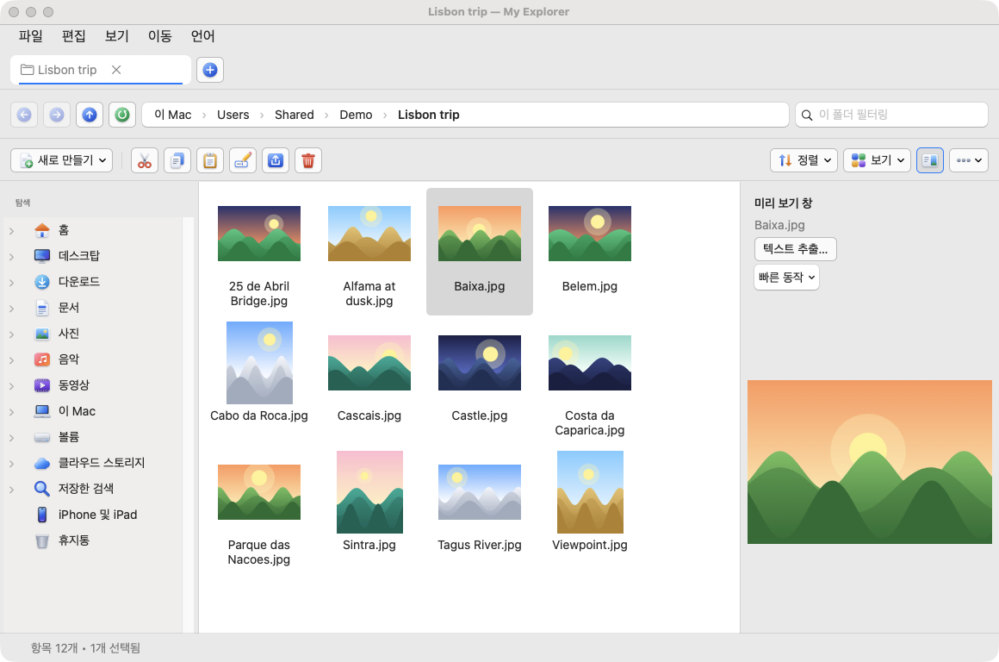
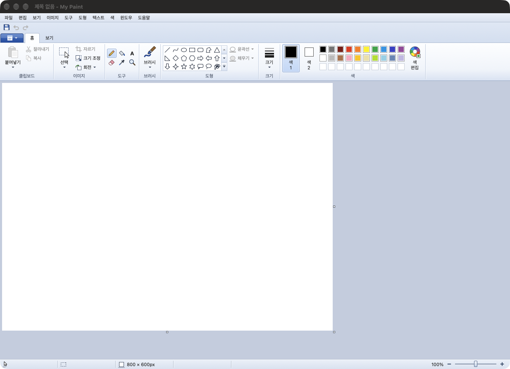

# My Suite

[Português (Brasil)](../../README.md) · [English](en.md) · [Español](es.md) · [Français](fr.md) · [Deutsch](de.md) · [Italiano](it.md) · [日本語](ja.md) · **한국어**

익숙한 메뉴와 단축키를 갖춘, 단순하고 간결한 macOS용 앱 세 가지입니다. 파일 관리자, 텍스트 편집기, 이미지 편집기로 이루어져 있습니다. 앱마다 저장소, 버전, 다운로드가 따로 있으며, 이 저장소는 세 앱을 하나의 설치 프로그램으로 묶습니다.

## 설치

- **[Apple Silicon(M 시리즈)용 다운로드](https://github.com/leoars/my-suite/releases/download/1.0.1/My-Suite-1.0.1-arm64.pkg)**
- **[Intel용 다운로드](https://github.com/leoars/my-suite/releases/download/1.0.1/My-Suite-1.0.1-x86_64.pkg)**

설치 프로그램에는 My Explorer 1.0.1, My Notepad 1.0.2, My Paint 1.0이 들어 있습니다. 설치 프로그램을 열고 **사용자화**에서 설치할 앱을 고르세요. 처음에는 세 가지가 모두 선택되어 있습니다. Developer ID로 서명되었고 Apple의 공증을 받았으며, 영어, 포르투갈어, 스페인어, 프랑스어, 독일어, 이탈리아어, 일본어, 한국어를 지원합니다.

macOS 12 이상이 필요합니다. My Explorer는 macOS 14 이상이 필요하며, 이전 버전에서는 선택되지 않은 상태로 표시되고 나머지 두 앱은 정상적으로 설치됩니다.

## My Explorer

폴더 트리, 탭, 명령 모음, 여러 보기 방식을 갖추고 휴지통, 볼륨, iCloud, Mac의 앱과 함께 동작하는 파일 관리자입니다.



- **탐색:** Mac의 폴더를 보여 주는 트리, 즐겨찾는 폴더와 최근 폴더, 탭별 방문 기록, 클릭하면 텍스트로 바뀌는 주소 표시줄, 와일드카드(`*.pdf`)를 쓸 수 있는 폴더 필터.
- **다섯 가지 보기 방식**(폴더별로 기억): 자세히, 목록, 작은 아이콘, 큰 아이콘, 갤러리. 사진과 동영상은 축소판으로 표시됩니다.
- **파일 작업:** 진행률 표시와 일시 정지를 지원하는 복사와 이동, 실행 취소, 되돌려 놓기를 지원하는 휴지통, ZIP, 폴더 크기까지 보여 주는 속성, 수천 개 파일의 빠른 삭제.
- **미리 보기:** 이미지, 비디오, 오디오, PDF를 미리 보기 창과 전용 뷰어에서 볼 수 있습니다.
- **그 밖에:** 이미지와 PDF의 텍스트 인식(OCR), iCloud Drive 상태, Amazon S3, 암호로 보호된 폴더, Git, SMB 서버 연결.

macOS 14 이상이 필요합니다. [My Explorer 자세히 보기](https://github.com/leoars/my-explorer/blob/main/README.ko.md)

## My Notepad

간단한 텍스트 편집기입니다. .txt 파일을 열고, 쓰고, 손에 익은 단축키로 저장하세요.


- **진짜 일반 텍스트:** 맞춤법 검사도, 자동 대치도, 숨은 서식도 없습니다.
- **찾기**, **바꾸기**, 줄 번호로 **이동**.
- **인코딩** ANSI, UTF-8, UTF-16을 자동으로 감지하며, 파일의 줄바꿈 형식을 그대로 유지합니다.
- **자동 줄 바꿈**, 글꼴 선택, 줄과 열을 보여 주는 상태 표시줄.
- 머리글과 바닥글을 지원하는 **페이지 설정**과 **인쇄**, 그리고 `.LOG`를 이용한 .txt 작업 일지.

macOS 12 이상이 필요합니다. [My Notepad 자세히 보기](https://github.com/leoars/My-Notepad/blob/main/docs/readme/ko.md)

## My Paint

간단한 이미지 편집기입니다. 이미지를 열고 연필, 브러시, 도형, 텍스트로 그린 뒤 PNG, JPEG, BMP, GIF로 저장하세요.



- **도구:** 연필, 지우개, 색 채우기, 색 선택, 돋보기, 텍스트.
- **브러시 9가지**와 갤러리의 **도형 23가지**, 윤곽선과 채우기 지원.
- **색:** 색 1과 색 2, 20색 팔레트, 사용자 지정 색.
- **선택:** 사각형 선택과 자유형 선택, 앱 간 잘라내기, 복사, 붙여넣기.
- **이미지:** 자르기, 크기 조정, 기울이기, 회전, 대칭.

macOS 12 이상이 필요합니다. [My Paint 자세히 보기](https://github.com/leoars/my-paint/blob/main/docs/readme/ko.md)

## 앱 간 연동

- My Explorer에서 텍스트 파일을 두 번 클릭하면 My Notepad가 열리고, 컨텍스트 메뉴에 **My Notepad로 편집**과 **My Paint로 편집**이 있습니다.
- 각 앱의 **정보** 윈도우에서 나머지 두 앱으로 이동할 수 있습니다.
- 어느 앱도 다른 앱에 의존하지 않습니다. 원하는 앱만 설치하세요.

## 업데이트

My Explorer는 새 버전을 스스로 확인하고, 사용자가 수락한 버전을 설치합니다. My Notepad와 My Paint는 이 설치 프로그램이나 각 앱의 설치 프로그램으로 새 버전을 설치하면 업데이트됩니다.

## 설치 프로그램 빌드

`build.sh`는 이미 출시되고 공증된 앱으로 설치 프로그램을 조립합니다. 여기서는 아무것도 컴파일하지 않습니다. 스위트 번호는 `VERSION`에 있습니다.

```sh
DEVELOPER_ID_INSTALLER="Developer ID Installer: …" NOTARY_PROFILE=my-suite-notary ./build.sh
```

[Apache 2.0 라이선스](../../LICENSE)로 배포됩니다.
