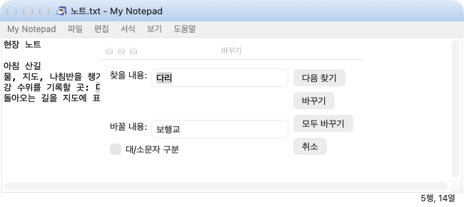

# My Suite

[Português (Brasil)](../../README.md) · [English](en.md) · [Español](es.md) · [Français](fr.md) · [Deutsch](de.md) · [Italiano](it.md) · [日本語](ja.md) · **한국어**

익숙한 메뉴와 단축키를 갖춘, 단순하고 간결한 macOS용 앱 네 가지입니다. 파일 관리자, 텍스트 편집기, 이미지 편집기, 계산기로 이루어져 있습니다. 앱마다 저장소, 버전, 다운로드가 따로 있으며, 이 저장소는 네 앱을 하나의 설치 프로그램으로 묶습니다.

## 설치

- **[Apple Silicon(M 시리즈)용 다운로드](https://github.com/leoars/my-suite/releases/download/1.0.9/My-Suite-1.0.9-arm64.pkg)**
- **[Intel용 다운로드](https://github.com/leoars/my-suite/releases/download/1.0.9/My-Suite-1.0.9-x86_64.pkg)**

설치 프로그램에는 My Explorer 1.0.6, My Notepad 1.0.7, My Paint 1.0.2, My Calc 1.0이 들어 있습니다. 설치 프로그램을 열고 **사용자화**에서 설치할 앱을 고르세요. 처음에는 네 가지가 모두 선택되어 있습니다. Developer ID로 서명되었고 Apple의 공증을 받았으며, 영어, 포르투갈어, 스페인어, 프랑스어, 독일어, 이탈리아어, 일본어, 한국어를 지원합니다.

macOS 12 이상이 필요합니다. My Explorer는 macOS 14 이상이 필요하며, 이전 버전에서는 선택되지 않은 상태로 표시되고 나머지 세 앱은 정상적으로 설치됩니다.

## My Explorer

폴더 트리, 탭, 명령 모음, 여러 보기 방식을 갖추고 휴지통, 볼륨, iCloud, Mac의 앱과 함께 동작하는 파일 관리자입니다.


### 탐색

- 폴더 트리에는 홈, 데스크탑, 문서, 다운로드, 이 Mac, 볼륨, 클라우드 스토리지, 저장한 검색, iPhone 및 iPad, 휴지통이 있고, 즐겨찾는 폴더와 최근 폴더도 있습니다.
- 탭마다 방문 기록, 선택, 정렬, 필터가 따로 유지됩니다.
- 주소 표시줄은 하나뿐입니다. 클릭할 수 있는 폴더 경로를 보여 주고, 표시줄을 클릭하면 텍스트 경로로 바뀌며, 입력하는 동안 제안을 표시합니다.
- **뒤로**, **앞으로**, **상위 폴더로**, **새로 고침**. 앱 밖에서 파일이 바뀌면 목록이 자동으로 갱신됩니다.
- **이 폴더 필터링**으로 와일드카드(`*.pdf`)를 써서 이름을 걸러 내고, **파일 검색…**으로 이름, 확장자, 내용, 날짜, 태그를 기준으로 이 폴더 또는 Mac 전체에서 검색합니다. 검색은 트리에 저장할 수 있습니다.

### 보기

- 보기 방식은 **자세히**, **목록**, **작은 아이콘**, **큰 아이콘**, **갤러리** 다섯 가지이며, 폴더별로 기억됩니다. 사진과 동영상은 축소판으로 표시됩니다.
- 이름, 수정한 날짜, 유형, 크기를 기준으로 **정렬**합니다. 자세히에서는 열 머리글을 드래그해 열의 순서나 너비를 바꿀 수 있습니다.
- 보기 메뉴에 **숨겨진 항목**과 **파일 확장명**이 있습니다.

### 파일 작업

- 명령 모음에 **새로 만들기**, **잘라내기**, **복사**, **붙여넣기**, **이름 바꾸기**, **공유**, **삭제**가 있습니다.
- 복사와 이동은 진행률 표시, 일시 정지, 검증을 지원합니다. 같은 이름이 이미 있으면 대치, 폴더 병합, 둘 다 유지, 건너뛰기 중에서 선택합니다.
- **실행 취소**로 세션 중의 복사, 이동, 삭제를 최대 20건까지 되돌릴 수 있고, F2 키로 그 자리에서 이름을 바꿀 수 있습니다.
- 트리에 휴지통이 있으며, **되돌려 놓기**, **영구 삭제…**, **휴지통 비우기…**를 사용할 수 있습니다.
- **ZIP으로 압축**과 **ZIP 압축 풀기**, 다른 앱과의 드래그 앤 드롭, **다음으로 열기…**, **공유…**(AirDrop 포함), Finder 태그, **경로 복사**.
- **속성**에서 경로와 권한을 확인합니다. 볼륨에서는 전체 용량, 사용한 용량, 남은 용량을 표시합니다.
- 이미지와 PDF를 위한 빠른 동작: 회전, JPEG 또는 PNG로 변환, PDF 만들기.

### 미리 보기와 미디어

- 미리 보기 창은 이미지, 재생 제어기가 있는 비디오와 오디오, 페이지를 넘길 수 있는 PDF, 서식이 적용된 Markdown(표, 작업 목록, 코드 강조 또는 소스)을 보여 주며, 그 밖의 유형은 훑어보기로 표시합니다.
- 전용 뷰어는 이미지, 비디오, 오디오를 열고, 화살표 키로 폴더의 파일을 차례로 넘기며, 1%에서 800%까지 확대/축소합니다. 움직이는 이미지(WebP, GIF, APNG)는 재생됩니다.

### 텍스트 인식(OCR)

- **텍스트 추출…**은 이미지와 스캔한 PDF에서 언어를 감지해 텍스트를 추출하며, 결과를 복사하거나 TXT로 저장할 수 있습니다.
- **검색 가능한 PDF 만들기…**는 파일 하나씩 또는 최대 50개까지 한꺼번에 실행할 수 있습니다. 모든 처리는 Mac에서 이루어집니다.

### iCloud와 클라우드 스토리지

- iCloud Drive 각 항목의 상태(Mac에 있음, 온라인 전용, 다운로드 중, 업로드 중)를 목록에 표시하고, 클릭 한 번으로 다운로드하며 아이콘에서 진행률을 보여 줍니다. **이 Mac에서 다운로드 제거**도 사용할 수 있습니다.
- 폴더 전체 또는 선택한 항목만 다운로드할 수 있으며, 남겨 두기로 한 디스크 여유 공간은 절대 침범하지 않습니다.
- Amazon S3: 버킷 연결, 탐색, Mac과 클라우드 간 복사, 이동, 폴더 생성, 삭제를 지원하며, 자격 증명은 macOS 키체인에 보관됩니다. Azure Blob Storage와 Google Cloud Storage는 실험적 기능입니다.

### 보호된 폴더, Git, 네트워크

- **폴더 보호…**는 AES-256으로 암호화되고 암호로 여는 보관함에 폴더를 넣어 둡니다. 보관함은 세션을 잠글 때, 잠자기에 들어갈 때, 종료할 때 자동으로 잠깁니다.
- Git: 파일의 상태 표시, 상태 막대의 브랜치, **변경 사항 보기**, **기록 보기**, 커밋, 브랜치 전환, fetch, pull, push를 지원하며, Mac에 설치된 Git을 사용합니다.
- 디스크 추출, SMB를 통한 **서버에 연결…**, iPhone 또는 iPad에서 사진 가져오기.

### 옵션과 단축키

- 열 때 탭 또는 마지막 폴더 복원, 트리, 목록, 메뉴, 막대별 서체 크기 지정, 시스템에 맞춰 바뀌는 라이트 또는 다크 테마.
- Ctrl 단축키는 이미 익숙한 방식 그대로 동작하며(Ctrl+C, Ctrl+V, F2, F5, 새 탭은 Ctrl+T), 이에 대응하는 ⌘ 단축키도 사용할 수 있습니다.
- 앱을 열 때 새 버전을 확인하고, 사용자가 수락한 버전을 설치합니다.
- 실험적 기능이며 기본적으로 꺼져 있습니다: 명령줄 도구와 MCP 서버를 통해 AI 도우미가 사용자가 허용한 폴더에서 24시간 동안 작업할 수 있습니다.

macOS 14 이상이 필요합니다. [My Explorer 자세히 보기](https://github.com/leoars/my-explorer/blob/main/README.ko.md)

## My Notepad

간단한 텍스트 편집기입니다. .txt 파일을 열고, 쓰고, 손에 익은 단축키로 저장하세요.



- **진짜 일반 텍스트:** 맞춤법 검사도, 자동 대치도, 숨은 서식도 없습니다.
- **파일:** 새로 만들기, 열기, 최근 항목 열기(마지막 파일 10개), 저장, 다른 이름으로 저장. 변경 내용을 잃기 전에 저장할지 묻고, 처음 실행할 때 .txt 파일의 기본 편집기로 사용할지 묻습니다.
- **창과 세션:** 문서마다 자체 창이 있고 **새 윈도우** 도 있습니다. 저장하지 않은 내용은 보관되어 닫을 때 묻지 않고 다음에 앱을 열 때 돌아옵니다. **설정…** 에서 다시 묻도록 바꿀 수 있습니다.
- 방향과 대/소문자 구분을 지정하는 **찾기**, 작업하는 동안 계속 열려 있는 창의 **바꾸기**와 **모두 바꾸기**, 줄 번호로 **이동**.
- **인코딩:** ANSI(CP-1252), UTF-8, UTF-16 LE, UTF-16 BE로 열고 저장하며 자동 감지를 지원합니다. 파일의 CRLF, LF, CR 줄바꿈 형식을 그대로 유지합니다.
- **보기:** 자동 줄 바꿈, 글꼴 선택, 키보드나 Ctrl 키와 마우스 휠로 조절하는 글자 크기, 줄과 열을 보여 주는 상태 표시줄.
- **인쇄:** 머리글, 바닥글(`&f`, `&p`, `&d`, `&t`), 여백, 용지 및 방향을 지정하는 페이지 설정.
- F5로 넣는 **시간/날짜**와 .txt 작업 일지: `.LOG`로 시작하는 파일은 열 때마다 끝에 시간과 날짜가 추가됩니다.
- **익숙한 단축키:** Ctrl+S, Ctrl+F, F3, Ctrl+H, Ctrl+G, Ctrl+Backspace 등을 그대로 쓸 수 있고, ⌘로도 사용할 수 있습니다.

macOS 12 이상이 필요합니다. [My Notepad 자세히 보기](https://github.com/leoars/My-Notepad/blob/main/docs/readme/ko.md)

## My Paint

간단한 이미지 편집기입니다. 이미지를 열고 연필, 브러시, 도형, 텍스트로 그린 뒤 PNG, JPEG, BMP, GIF로 저장하세요.


- **파일:** PNG, JPEG, BMP, GIF, TIFF를 열고 저장하며, 최근 그림, 이미지 속성, 데스크탑 배경으로 설정을 지원합니다.
- **도구:** 연필, 지우개, 색 채우기, 색 선택, 돋보기, 텍스트. 왼쪽 버튼은 색 1로, 오른쪽 버튼은 색 2로 그립니다.
- **브러시 9가지**: 캘리그래피 브러시, 에어브러시, 유화 브러시, 크레용, 수채화 브러시 등이 있으며, 브러시마다 크기가 네 가지입니다.
- 갤러리의 **도형 23가지**: 윤곽선과 채우기는 단색 또는 질감으로 지정하고, 확정하기 전에 핸들로 조정할 수 있습니다.
- **색:** 20색 팔레트, 사용자 지정 색, 색상·채도·명도 또는 빨강·녹색·파랑으로 조정하는 색 편집.
- **선택:** 사각형 선택, 자유형 선택, 투명하게 선택. 이동, 복제, 늘이기, 앱 간 붙여넣기.
- **이미지:** 자르기, 크기 조정 및 기울이기, 회전, 대칭, 색 반전. 선택 영역이나 이미지 전체에 적용됩니다.
- **텍스트:** 글꼴, 크기, 굵게, 기울임꼴, 밑줄, 취소선. 일본어와 한국어 입력기를 지원합니다.
- **보기와 인쇄:** 12.5%에서 800%까지 확대/축소, 눈금자, 눈금선, 전체 화면, 미리 보기, 인쇄 미리 보기, 50단계 실행 취소.

macOS 12 이상이 필요합니다. [My Paint 자세히 보기](https://github.com/leoars/my-paint/blob/main/docs/readme/ko.md)

## My Calc

간단한 계산기입니다. 표준, 공학용, 프로그래머 모드에서 손에 익은 키와 단축키로 계산하세요.


- **표준:** 사칙연산, 백분율, 역수, 제곱, 제곱근. 키를 누른 순서대로 계산합니다.
- **공학용:** 연산자 우선순위와 괄호. 도, 라디안, 그라디안 단위의 삼각함수, 거듭제곱, 로그, 계승.
- **프로그래머:** 숫자를 HEX, DEC, OCT, BIN으로 동시에 표시. 8~64비트 워드, 비트 연산, 64비트 패널.
- **메모리와 기록:** MS, MR, M+, M−, MC와 저장한 숫자 목록, 계산 기록. 숫자나 식 전체를 복사하고 붙여넣기.
- 유효 숫자 32자리의 **10진 연산**: 0.1 + 0.2는 0.3입니다.
- 시스템에 맞춘 밝은 모드 또는 어두운 모드, 크기를 바꿀 수 있는 윈도우, **항상 위에 유지**.

macOS 12 이상이 필요합니다. [My Calc 자세히 보기](https://github.com/leoars/my-calc/blob/main/docs/readme/ko.md)

## 앱 간 연동

- My Explorer에서 텍스트 파일을 두 번 클릭하면 My Notepad가 열리고, 컨텍스트 메뉴에 **My Notepad로 편집**과 **My Paint로 편집**이 있습니다.
- 네 앱 모두 **정보** 윈도우에서 나머지 세 앱으로 이동할 수 있습니다.
- 어느 앱도 다른 앱에 의존하지 않습니다. 원하는 앱만 설치하세요.

## 업데이트

네 앱 모두 앱을 열 때 새 버전을 확인하고, 사용자가 수락한 버전을 설치합니다. 각 앱의 옵션 또는 설정에 **시작할 때 업데이트 확인** 과 **지금 확인** 이 있습니다. My Notepad와 My Paint는 버전 1.0.5와 1.0.1부터 지원합니다. 수락하면 새 설치 프로그램을 확인한 뒤 macOS 설치 프로그램에서 엽니다. 그 이전 버전을 사용 중이라면 이 설치 프로그램이나 각 앱의 설치 프로그램으로 한 번만 업데이트하세요.

## 설치 프로그램 빌드

`build.sh`는 이미 출시되고 공증된 앱으로 설치 프로그램을 조립합니다. 여기서는 아무것도 컴파일하지 않습니다. 스위트 번호는 `VERSION`에 있습니다.

```sh
DEVELOPER_ID_INSTALLER="Developer ID Installer: …" NOTARY_PROFILE=my-suite-notary ./build.sh
```

[Apache 2.0 라이선스](../../LICENSE)로 배포됩니다.
